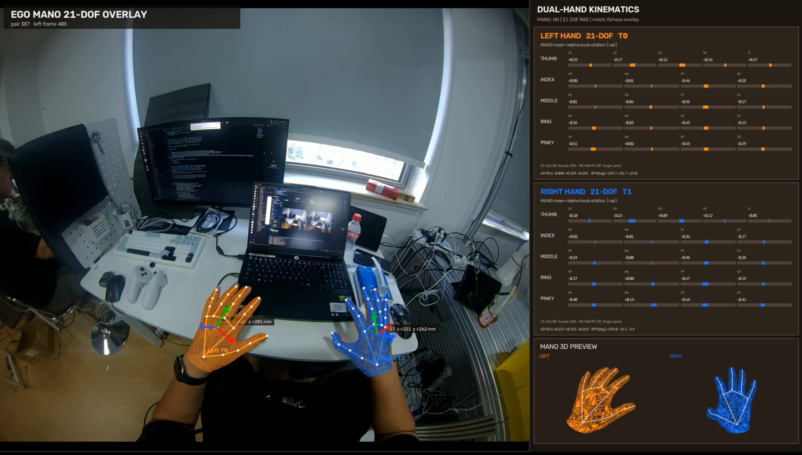
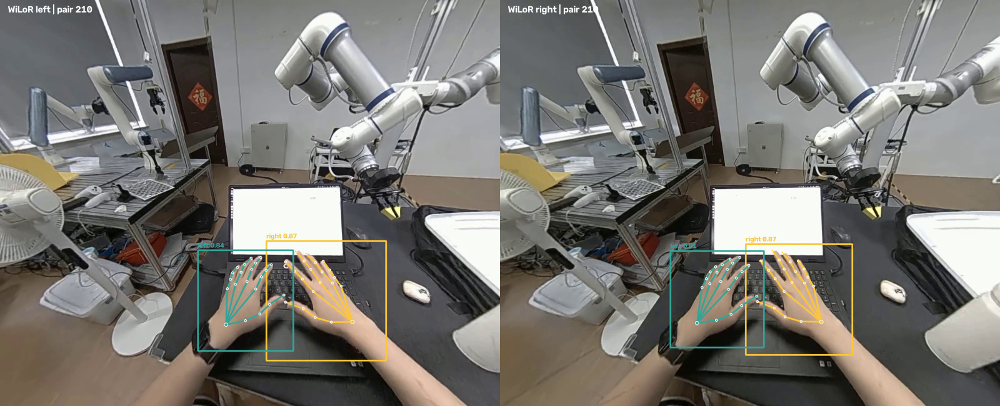

# EGO Hand System

面向头戴式双目相机的离线手部重建与 MANO 拟合系统。当前主要支持两种输入：

- `orbbec`：Orbbec EGO 左右视频、硬件时间戳、KB 鱼眼标定和可选 IMU；
- `gen`：GEN DAS EGO MCAP/H264、KB 或 Double Sphere 双目标定。

当前系统包含统一的双目主流程，以及 GEN 六目 WiLoR 扩展流程：

```text
Orbbec EGO session ─────┐
                         ├─> 双目数据标准化 ─> 双目校正(KB/DS) ─┬─> MediaPipe 双路检测
GEN 双目 MCAP ──────────┘                                      │   └─> 左右手关联
                                                               │       └─> 三角化得到 3D 关节
                                                               │           └─> 3D 稳定化
                                                               │               └─> MANO 时序拟合
                                                               │                   └─> MANO 网格
                                                               │                       + 21-DOF
                                                               │                       + 6D 位姿
                                                               │
                                                               └─> WiLoR 双路推理
                                                                   └─> 21 个关键点
                                                                       + MANO 参数/网格

GEN 六目 MCAP(camera0~camera5)
          └─> 六路标准化 + 微秒级同步 + DS 标定
              └─> 六路 detector + WiLoR 双姿态推理
                  └─> detector 左右手身份锁定
                      └─> 动态锚点 + DS 射线三角化 + 逐关节 RANSAC
                          └─> 六目融合 21 个 3D 关键点
                              ├─> MANO 时序拟合
                              │   └─> MANO 网格和姿态参数
                              └─> WiLoR 自动标签导出
                                  └─> images/*.jpg + labels/*.npy
```

Orbbec 和 GEN 双目数据经过标准化、校正后，可通过 `EGO_HAND_ROUTE` 选择
MediaPipe、WiLoR 或并行运行。GEN 六目流程使用独立的多视角 Double-Sphere
几何融合；camera2/3 校正视图主要用于 MANO 约束和 WiLoR 训练标签导出。

## 效果展示



Orbbec EGO 离线处理结果：左侧在原始鱼眼画面上叠加双手 MANO 网格、骨架和
末端 6D 坐标轴；右侧同步显示左右手 21-DOF 数值及独立 MANO 3D 预览。



同一组校正双目数据的 WiLoR 左右目独立结果：每路显示手框、左右手分类、置信度和
21 点投影骨架；逐帧数值结果同时保存为 JSONL 和 NPZ。

## 离线启动

下面的命令覆盖环境、源码、模型资产和完整运行。只需要把尖括号中的占位符替换成
你自己的路径；没有 WiLoR 模型时，把 `EGO_HAND_ROUTE` 改为 `mediapipe`。

### 一次性安装环境和公共依赖

```bash
cd <ego_hand_system目录>
./scripts/setup_python_environment.sh
conda activate ego-hand
unset PYTHONPATH
git submodule sync --recursive
git submodule update --init third_party/MANO third_party/basalt third_party/WiLoR
./scripts/install_mediapipe_model.sh
```

`environment.yml` 只负责创建稳定的 Python/Conda 基础环境；安装脚本会继续完成完整、
固定版本的运行时安装。它把 CUDA PyTorch、普通 PyPI 包和 chumpy 分开处理，避免普通
包误访问 PyTorch CUDA 下载源，也避免一次下载中断导致整个 Conda 环境创建失败。

MANO v1.2 模型需要旧版 chumpy 来反序列化。chumpy 的 GitHub 源码构建脚本与现代 pip
的隔离构建不兼容，因此安装脚本会明确执行固定提交的非隔离构建：

```bash
python -m pip install --no-build-isolation \
  git+https://github.com/mattloper/chumpy.git@580566eafc9ac68b2614b64d6f7aaa84eebb70da
```

项目在加载 MANO 时还会补上 chumpy 所需的 NumPy 2 兼容别名。安装完成后，脚本会
自动检查 WiLoR、MediaPipe、GEN、PyTorch/CUDA 和 OpenCV 包是否可用。如果网络中断，
重新执行 `./scripts/setup_python_environment.sh` 即可；已下载内容保存在 `/tmp/ego-hand-pip-cache`。
脚本也会清理 `ultralytics` 可能引入的 `opencv-python`，然后修复安装项目统一使用的
`opencv-contrib-python`，避免两个提供同名 `cv2` 模块的发行包互相覆盖。
当前官方 `detector.pt` 含有 `C3k2` 层，因此安装脚本固定使用与该权重一致的
Ultralytics 8.4.56；环境检查也会在版本或模型层不兼容时提前报出明确错误。

准备授权资产。MANO 的两个 pkl 从官方页面下载后安装，放到models/MANO。WiLoR checkpoint 和 detector
从官方 Hugging Face Space 下载：

```bash
cd <ego_hand_system目录>
mkdir -p models/wilor
wget https://huggingface.co/spaces/rolpotamias/WiLoR/resolve/main/pretrained_models/detector.pt \
  -P models/wilor/
wget https://huggingface.co/spaces/rolpotamias/WiLoR/resolve/main/pretrained_models/wilor_final.ckpt \
  -P models/wilor/
wget https://huggingface.co/spaces/rolpotamias/WiLoR/resolve/main/pretrained_models/model_config.yaml \
  -P models/wilor/
python scripts/check_third_party.py --require-mano --require-wilor
```

### GEN DAS EGO：完整运行

```bash
cd <ego_hand_system目录>
conda activate ego-hand

# 必须填写
export EGO_SOURCE=gen
export EGO_MCAP=<MCAP文件绝对路径>
export EGO_OUTPUT=<新输出目录绝对路径>

# 可选；以下均可不填写，右侧是默认值或示例值
export EGO_LEFT_CAMERA=camera2       # 默认 camera2
export EGO_RIGHT_CAMERA=camera3      # 默认 camera3
export EGO_HAND_ROUTE=parallel       # mediapipe | wilor | parallel
export EGO_DEVICE=auto               # auto | cuda | cpu
export EGO_MAX_PAIRS=0               # 冒烟测试可改为 60
export EGO_MAX_FRAMES=0              # GEN 解码帧数；0 表示全部
export EGO_NO_VIDEO=0                # 1 表示跳过诊断视频
export EGO_WILOR_CAMERAS=both        # left | right | both
export EGO_WILOR_BATCH_SIZE=4
export EGO_WILOR_FRAME_STRIDE=1
./scripts/run_offline.sh check
./scripts/run_offline.sh all
```

### Orbbec EGO：完整运行

```bash
cd <ego_hand_system目录>
conda activate ego-hand

# 必须填写
export EGO_SOURCE=orbbec
export EGO_SESSION=<Orbbec会话目录绝对路径>
export EGO_OUTPUT=<新输出目录绝对路径>

# 可选；以下均可不填写，右侧是默认值或示例值
export EGO_HAND_ROUTE=parallel       # mediapipe | wilor | parallel
export EGO_DEVICE=auto               # auto | cuda | cpu
export EGO_MAX_PAIRS=0
export EGO_NO_VIDEO=0
export EGO_WILOR_CAMERAS=both
export EGO_WILOR_BATCH_SIZE=4
./scripts/run_offline.sh check
./scripts/run_offline.sh all
```

### GEN 六目 WiLoR 实验

完整设计、算法改进、指标、左右手身份修复和排错记录见
[`docs/GEN_SIX_CAMERA_WILOR_FUSION.md`](docs/GEN_SIX_CAMERA_WILOR_FUSION.md)。
camera2/3 锚点选择、DS 射线、外围相机关联和逐关节 RANSAC 的详细过程见
[`docs/GEN_MULTIVIEW_RANSAC_ANCHOR_FUSION.md`](docs/GEN_MULTIVIEW_RANSAC_ANCHOR_FUSION.md)。
从原始 MCAP 到 `images/*.jpg + labels/*.npy` 的完整操作步骤见
[`docs/GEN_SIX_CAMERA_WILOR_LABEL_EXPORT_GUIDE.md`](docs/GEN_SIX_CAMERA_WILOR_LABEL_EXPORT_GUIDE.md)。
如果使用 NOKOV/XINGYING 光学动捕的 24 点手部模型生成 WiLoR 标签，见
[`docs/NOKOV_OPTICAL_MOCAP_TO_WILOR_LABELS.md`](docs/NOKOV_OPTICAL_MOCAP_TO_WILOR_LABELS.md)。
戴有反光 marker 球的黑色手套可以直接用原始 RGB 图像辅助 WiLoR，见
[`docs/GEN6_GLOVE_MARKER_WILOR_ASSIST.md`](docs/GEN6_GLOVE_MARKER_WILOR_ASSIST.md)。该功能默认
关闭；启用后逐帧检测亮点并修正 WiLoR 的二维投影，不读取 NOKOV CSV，也不修改相机标定。
如果要用 SAM3 对防护手套做掩膜验证、保守修正 2D 骨架并参与六目 3D 融合，见
[`docs/GEN6_SAM3_GLOVE_WILOR_ASSIST.md`](docs/GEN6_SAM3_GLOVE_WILOR_ASSIST.md)。该功能同样默认
关闭，原始 WiLoR 预测会保留用于 A/B 对比和安全回退。

主流程仍是 `camera2+camera3` 双目。以下独立实验链路会一次读取
`camera0..camera5`，以 `camera2` 时间戳同步六路原始 DS 鱼眼视频，对每路运行左右手
双假设 WiLoR，以 `camera2/3` 为首选锚点并在缺失时动态选择其他相机对，再让外围
相机逐只手按重投影匹配，最后用原生 Double-Sphere 射线和 RANSAC 融合 3D 关节：

最终 Left/Right 身份由 `detector.pt` 的 `left/right` 类别严格锁定；双假设只用于估计
对应身份的姿态，几何误差和手掌翻转不能再交换两只手。汇总中的
`detector_handedness_mismatch_observation_count` 应为 `0`。

```bash
cd <ego_hand_system目录>
conda activate ego-hand
./scripts/run_multiview_wilor_experiment.sh \
  --mcap <MCAP文件绝对路径> \
  --output <新的六目实验输出目录> \
  --device cuda \
  --max-frames 60 \
  --batch-size 4 \
  --glove-marker-assist 1
```
```bash
./scripts/run_multiview_wilor_experiment.sh \
    --mcap       /home/p3/data_sda1/ego_hand_system/recordings/20260818/DAS-Ego_20260818164752_none_none_689985_b5adb46c.mcap \
    --output     /home/p3/data_sda1/ego_hand_system/output/gen6_pose_full_v5_5090d \
    --conda-env  ego-hand \
    --device     cuda \
    --gpu-profile rtx5090d \
    --max-frames 0 \
    --glove-marker-assist 1
```

`--gpu-profile rtx5090d` 会使用 16 帧检测批次、64 个 WiLoR 假设批次、16 个并行
OpenCV 抗锯齿裁剪线程、锁页内存异步传输和 H.264 解码预取、FP16 autocast/TF32，
并仅在每路相机结束后清理 CUDA 缓存。若 24 GB 显存仍不足，推理会自动将 WiLoR
假设批次减半并重试。
WiLoR backbone 默认通过 `torch.compile` 合并 CUDA kernel；首次运行会有一次编译等待，
之后的完整序列会摊薄该开销。
由于严格 handedness 模式下每帧物理上最多只有一只左手和一只右手，该配置还会为
每个 detector 类别只保留最高置信度框，避免低阈值侧相机的重复假框成倍运行 WiLoR。
RTX 5060 保持默认的
`--gpu-profile compatible --batch-size 4`，继续使用原有逐帧 FP32 路径。可用
`--frame-batch-size` 和 `--preprocess-workers` 单独覆盖批次与裁剪线程数；显存不足
时先把 `--batch-size` 从 `64` 降为 `32`，再把帧批次从 `16` 降为 `8`。
如需保留所有候选框，可显式传入 `--max-detections-per-class 0`。
如当前 PyTorch/驱动组合无法编译，可用 `--compile-backbone 0` 关闭编译，其余 5090D
优化仍然保留。
5090D profile 还会使用 8 个 CPU 进程并行处理相互独立的逐帧多视角 RANSAC；候选
重投影按相机批量计算，并限制每个 worker 内部的 BLAS 线程数。可用
`--fusion-workers N` 单独调整。融合阶段每 25 帧输出一次当前吞吐率。

如需从新的 GEN MCAP 只运行四目，例如 `camera1~camera4`，可直接指定相机子集：

```bash
./scripts/run_multiview_wilor_experiment.sh \
  --mcap /path/to/new_recording.mcap \
  --output /path/to/gen4_new_run \
  --cameras camera1 camera2 camera3 camera4 \
  --reference-camera camera2 \
  --device cuda \
  --max-frames 60
```

脚本会自动使用 `camera2/3` 作为锚点，并生成 `diagnostic_4view.mp4`；确认冒烟测试后将
`--max-frames` 改为 `0` 运行完整数据。

### 鱼眼去畸变与原图对比

`scripts/run_multiview_wilor_undistorted_experiment.sh` 在检测前将多路 KB/GEN-DS
鱼眼图像转换为针孔视图，并携带新标定运行同一套 WiLoR、融合及渲染流程；
原来的 `run_multiview_wilor_experiment.sh` 默认仍直接处理原图。
两组实验使用不同输出目录，可用 `compare_multiview_wilor_undistortion.py` 比较检测覆盖、
3D 输出覆盖及原图坐标下的配对残差。命令、视场角设置和评价限制见
[鱼眼去畸变对比指南](docs/MULTIVIEW_WILOR_UNDISTORTION_COMPARISON.md)。
去畸变入口追加 `--original-video`，可额外生成 `final_on_original_Nview.mp4`：
在原始鱼眼视频上显示回投影后的融合 3D、2D 回退骨架和检测框；已有推理与融合结果可直接复用。

### 新 Orbbec EGO Pro 四目 MCAP：原始 WiLoR 基线

新款 EGO Pro 录制目录（包含一个 `.mcap` 和对应 `meta_*.json`）使用以下适配脚本：

```bash
./scripts/run_orbbec_multiview_wilor.sh \
  --input /home/p3/data_sda1/ego_hand_system/recordings/new/EGO_Pro_AZLR86000F7_20260917_170004 \
  --output /home/p3/data_sda1/ego_hand_system/output/orbbec_20260917_170004_raw_wilor \
  --conda-env ego-hand --device cuda --gpu-profile rtx5090d --max-frames 0 \
  --optimized-video
```

它把 `/camera/left`、`right`、`right_side`、`left_side` 无损 remux 为
`camera0..camera3`，与四路 MP4 导出的 `cam_0..cam_3` 顺序一致；按设备时间戳同步，
然后逐路运行双假设 WiLoR。输出的
`fusion_multiview/raw_wilor_2d_4view.mp4` 只画原始相机内 2D 框和 21 点骨架，不启用
SAM3、三角化、3D 融合或时序修正。这个 MCAP 没有 `camera_info`，因此适配器不会伪造
标定；要做 3D 融合，需另行提供每路内参/畸变和统一坐标系外参，可通过
`--calibration-dir` 传入 `camera0.json` ... `camera3.json`，并核对相同设备序列号和安装状态。增加 `--optimized-video` 后还会
生成 `fusion_multiview/optimized_wilor_2d_dedup_quality15_4view.mp4`：它只应用之前验证过的
二维身份锁定、重复框合并、短时序保持和可见关节质量门控，不改变原始预测文件。

### Orbbec EGO Pro 四路 MP4 导出：复用 GEN 多视角链路

若需要各相机坐标下的 WiLoR 三维关节、手腕位姿与 MANO 网格，可使用
`scripts/run_orbbec_wilor_3d.py`。它支持现有四路 MP4 与 KB 标定，输出每目 NPZ、
位姿 CSV、OBJ 样例及网格叠加视频；这是独立单目估计，未做多目几何融合。
执行命令和字段含义见 [WiLoR 相机坐标 3D 输出指南](docs/ORBBEC_EGO4_WILOR_CAMERA_3D.md)。

使用 `detector_1009.pt` 运行四目融合并对接 Basalt VIO 的流程，见
[Orbbec 多目手部与 OmniEgoCap 输入适配](docs/ORBBEC_MULTIVIEW_OMNIEGOCAP.md)。
最终人体头部轨迹需安装外参与地面高度；该指南也记录本次已确认的 IMU 位置、首帧中立姿态、
约 1.70 m 高度近似方案。

`recordings/20260928` 这类录制目录包含四路 MP4、各路 `*_pts.csv` 和
`*_calibration_camera.yaml`。规范化器使用 YAML 中的相机 ID 建立映射：
`camera0=left/cam_0`、`camera1=right/cam_1`、`camera2=right_side/cam_2`、
`camera3=left_side/cam_3`。输入适配器输出与 GEN 相同的 `normalized_multiview`
数据格式，并保留 KB 鱼眼标定。后续复用 GEN 的逐路双假设 WiLoR、跨视角匹配、
3D 融合、关节时序与质量后处理、诊断渲染链路；融合及后处理判据与 GEN 保持一致。

先运行 60 帧检查数据适配和融合结果：

```bash
./scripts/run_multiview_wilor_experiment.sh \
  --session recordings/20260928/EGO_Pro_AZLR86000F7_20260928_135841 \
  --output output/0928/ego4_135841_anchor01 --max-frames 60 --device cuda
```

输出 `fusion_multiview/diagnostic_4view.mp4` 和相应的融合结果。EGO4 四目恢复
`camera0, camera1` 的首选锚点顺序；这对相机在当前帧不可用或未通过质量检查时，
再尝试其他相机对。
输入适配还设置相机选择、主视角、
标定模型及其射线反投影，不启用额外的单手双目放宽判据。
如需最终交付视频，添加 `--final-video`。对这段录制前 60 帧的实测中，WiLoR
四路分别只在 17、2、5、10 帧检出手；GEN 严格融合判据接受 0 帧，原因是没有形成
“两路相机同时观测到双手”的有效锚点。原始四目 MCAP 的 2D 基线仍可通过
`run_orbbec_multiview_wilor.sh` 单独运行，适合定位检测问题。确认 60 帧后，
使用新目录和 `--max-frames 0` 跑完整录制。
旧目录 `output/0928/ego4_135841` 使用了不同的左右手处理和单手双目判据，
不能用于当前 GEN 严格链路的断点续跑。

需要把融合结果送入 MANO 序列拟合时，选择主视角双目导出：

```bash
conda run --no-capture-output -n ego-hand env PYTHONPATH=scripts \
  python scripts/prepare_multiview_mano_input.py \
  --dataset output/0928/ego4_135841_anchor01/normalized_multiview \
  --fusion output/0928/ego4_135841_anchor01/fusion_multiview \
  --left-camera camera0 --right-camera camera1 \
  --output output/0928/ego4_135841_anchor01/mano_input.npz \
  --rectification-output output/0928/ego4_135841_anchor01/mano_rectification.npz
```

`recordings/20260928` 下的每个录制子目录单独指定给 `--session`，并使用各自的输出目录。

如果只需要接近第一人称演示的连续骨架画面，可从已完成的逐相机预测生成单主视角视频：

```bash
conda run --no-capture-output -n ego-hand env PYTHONPATH=scripts \
  python scripts/render_native_2d_multiview.py \
  --dataset output/0928/ego4_135841_test/normalized_multiview \
  --predictions output/0928/ego4_135841_test/wilor_multiview \
  --output output/0928/ego4_135841_test/hand_pose_single_view_final.mp4 \
  --cameras camera0 --columns 1 --tile-width 1200 --crop-top-px 300 \
  --min-visible-joints 15 --max-hold-frames 2 --overlay-style clean
```

`--crop-top-px 300` 只针对 `135841` 中双手始终位于画面下方的录制验证过；其它录制应先检查手是否会进入裁掉的区域。`clean` 仅隐藏诊断框和文字，不改变关节数据。`native_2d` 视频展示的是 2D 跟踪，不能作为 3D 精度证明。

需要保留只有一只手通过多视角质量门限的帧时，在新输出目录运行 EGO4 流程并加 `--allow-single-hand-anchors 1`。这个选项仍要求至少两路真实观测通过几何检查；默认值保持为 `0`。在 `135841` 前 60 帧，开启后保留了原有 39 帧双手结果，并增加 20 帧单手结果。

确认 60 帧冒烟测试后，把 `--max-frames` 改成 `0`，同时使用新的输出目录运行完整
序列。脚本会生成 `fusion_multiview/diagnostic_6view.mp4`，其中六个画面按 3x2 排列；
绿色 `USED` 显示该相机实际贡献的内点关节，灰色 `INACTIVE` 表示未参与，红色
`OUTLIER/REJECTED` 显示离群候选或整帧拒绝原因。
短缺口会由邻近已确认姿态引导六路当前帧重新关联；恢复帧仍须至少两个相机的真实
观测通过 RANSAC，不直接使用关节插值代替识别。
`fusion_multiview/summary.json` 还会把六目结果和 `camera2+camera3` 双目结果投影到所有
可用视角，给出跨视角一致性对比。

`--glove-marker-assist 1`（兼容旧别名 `--nokov-wilor-assist 1`）执行真正的逐帧视觉辅助：

1. 原图转 HSV，保留低饱和度且亮度大于 `160` 的像素；
2. 连通域筛选小而近似圆形的亮斑；
3. 先按 detector 框把亮斑分配给具体的手，再在当前 WiLoR 投影附近保留候选；
4. 从最近邻估计粗略二维偏移，用带手指归属和同指顺序检查的匈牙利算法一对一匹配；
5. 3 点/2 指以上只作为弱假设选择证据；至少 8 点/4 指且残差达标时才修正关节；
6. 整手实际移动最多 `10 px`，单个关节局部拉动最多 `3 px`，骨长变化超限时取消局部拉动。

默认参数可用 `--marker-value-min`、`--marker-saturation-max`、
`--marker-min-matches`、`--marker-global-min-matches`、
`--marker-global-min-finger-groups` 和 `--marker-blend` 调整。启用后原始
`wilor_multiview/` 保持不变，新增 `wilor_multiview_glove_marker_assisted/` 和
`fusion_multiview_glove_marker_assisted/`。每个相机目录中的
`marker_assist_preview.jpg` 保存位移/残差最大的已修正案例，
`marker_evidence_preview.jpg` 保存接近修正门限但仅作为证据的案例。融合诊断视频也会显示
`MARKER N`。找不到强支持的手不会被强行修正，而是保留原始 WiLoR 关节。

戴手套时 detector 的左右类别可能同时判成同一侧，因此该开关默认采用逐帧
`--detector-handedness adaptive`：先执行严格身份融合，只有严格结果拒绝该帧时，才用
多视角几何与 marker 证据重试。可显式传入 `strict` 强制旧规则，或传入 `ignore` 始终由
几何选择身份；后两种模式都应单独检查左右手稳定性。

如果一个目录中有多个 MCAP，可使用批处理入口运行。`rtx5090d` 默认启用两级流水线：
下一条记录执行 GPU inference 时，上一条记录同时执行 CPU fusion 和 NVENC render；
可用 `--pipeline 0` 恢复严格串行。每个 MCAP 使用文件名创建独立输出目录，某个文件
失败后默认继续下一个：

```bash
./scripts/run_multiview_wilor_batch.sh \
  --input-dir /home/p3/data_sda1/ego_hand_system/recordings/20260818 \
  --output-root /home/p3/data_sda1/ego_hand_system/output/gen6_batch_5090d \
  --conda-env ego-hand \
  --device cuda \
  --gpu-profile rtx5090d \
  --max-frames 0 \
  --preprocess-workers 16 \
  --fusion-workers 16
```

视频编码会优先使用 PyAV 的 `h264_nvenc`，不可用时自动回退到 OpenCV `mp4v`。
渲染会并行读取六路视频并预取下一帧；添加 `--final-video` 时，先生成诊断版，再生成
保守的 trusted-3D/native-2D 混合交付版（可用 `EGO_FINAL_RENDERER=fused` 显式恢复纯
融合 3D）。混合版只在深度几何可靠时显示 3D，否则显示该相机的原生 2D，避免扭曲手指。
normalization 的 remux 完整性校验也会优先使用六路并行 `h264_cuvid`/NVDEC，不支持
NVDEC 的机器自动回退到软件 H.264 解码。

批量输出示例：

```text
gen6_batch_5090d/
├── batch_summary.json
├── batch_status.jsonl
├── DAS-Ego_20260818164752_.../
│   ├── run_config.json
│   ├── normalized_multiview/
│   ├── wilor_multiview/
│   └── fusion_multiview/
├── DAS-Ego_20260818164752_....log
└── ...
```

`batch_summary.json` 汇总每个文件的成功/失败、耗时、输出目录和日志路径；单个目录内的
`run_config.json` 仍负责断点复用和参数一致性检查。可先加 `--dry-run` 只检查将要执行的
文件和命令；需要递归搜索子目录时加 `--recursive`。

### 多个实验批量生成训练标签

上一步批量生成多个实验后，标签也可以批量导出。各实验分别保存：

```bash
./scripts/run_multiview_wilor_label_batch.sh \
  --experiment-root /home/p3/data_sda1/ego_hand_system/output/gen6_batch_5090d \
  --layout separate \
  --conda-env ego-hand --device cuda --gpu-profile rtx5090d \
  --export-camera camera2 --view-filter complete21 \
  --max-samples 0
```

默认写入每个实验自己的 `wilor_labels_camera2_complete21/`。如果希望分别保存，但集中放到
另一个根目录，再增加 `--output-root /path/to/separate_labels`。

如果希望所有录制最终合并成同一个训练数据集：

```bash
./scripts/run_multiview_wilor_label_batch.sh \
  --experiment-root /home/p3/data_sda1/ego_hand_system/output/gen6_batch_5090d \
  --output-root /home/p3/data_sda1/ego_hand_system/output/wilor_labels_merged \
  --layout merged \
  --visualization-samples 20 \
  --view-filter complete21 \
  --sample-stride 10 \
  --conda-env ego-hand --device cuda --gpu-profile rtx5090d \
  --export-camera camera2 --view-filter complete21 \
  --max-samples 0
```

合并模式在 `runs/<实验名>/` 保留每段录制的 MANO 拟合和断点缓存，最终训练集位于
`dataset/`。图片和标签统一重新编号，`.npy` 内容不修改，`index.jsonl` 额外记录来源实验。
`rtx5090d` 标签配置使用 CUDA 拟合和大批次 GPU 校验。实测并发拟合会产生 GPU 争用，
因此默认 `--workers 1`；`--workers 2|3` 仅建议在独占 GPU 时试验。

### GEN 四目子集测试

已有六路标准化数据和 WiLoR 预测时，可以只选择部分相机重新融合，不需要重复运行模型。
例如使用 `camera1~camera4`，并继续以 `camera2/3` 为首选锚点：

```bash
PYTHONPATH=scripts conda run --no-capture-output -n ego-hand \
  python scripts/fuse_multiview_wilor_guided.py \
  --dataset output/gen6_pose_full_v3/normalized_multiview \
  --predictions output/gen6_pose_full_v3/wilor_multiview \
  --output output/gen6_pose_full_v3/fusion_cam1_to_cam4_strict_full \
  --cameras camera1 camera2 camera3 camera4 \
  --anchor-cameras camera2 camera3 \
  --detector-handedness strict \
  --max-frames 0

PYTHONPATH=scripts conda run --no-capture-output -n ego-hand \
  python scripts/render_multiview_wilor.py \
  --dataset output/gen6_pose_full_v3/normalized_multiview \
  --fusion output/gen6_pose_full_v3/fusion_cam1_to_cam4_strict_full \
  --output output/gen6_pose_full_v3/fusion_cam1_to_cam4_strict_full/diagnostic_4view.mp4 \
  --cameras camera1 camera2 camera3 camera4 \
  --columns 2
```

四目视频按 `camera1 | camera2 / camera3 | camera4` 的 2×2 布局生成。冒烟测试可先将两个
命令都加上 `--max-frames 60`，正式运行时使用 `0` 或省略限制。

六目结果确认无误后，可以直接导出与 WiLoR 训练数据一致的成对图片和 `.npy` 标签：

```bash
./scripts/run_multiview_wilor_label_export.sh \
  --experiment /home/zdh/ego_hand_system/output/gen6_pose_full_v3 \
  --fusion /home/zdh/ego_hand_system/output/gen6_pose_full_v3/fusion_handedness_strict_full \
  --output /home/zdh/ego_hand_system/output/gen6_pose_full_v3/wilor_training_labels_physical_v1 \
  --conda-env ego-hand \
  --device cuda \
  --max-samples 0
```

标签导出默认使用运动自适应抽帧：静止阶段降低采样率，手部明显移动或手身份出现变化时保留关键帧。
如需固定抽帧，例如每 3 个同步帧保留 1 帧，增加：

```bash
  --sample-stride 3
```

`--sample-stride 0`（默认）表示运动自适应；`--max-samples` 仍然只是最终数量上限。

如果训练集只需要 `camera2`，并且要求该相机自身完整观测到 21 个关节，可使用：

```bash
  --export-camera camera2 \
  --view-filter complete21
```

```bash
./scripts/run_multiview_wilor_label_export.sh \
  --experiment /home/zdh/ego_hand_system/output/gen4_new_run \
  --fusion /home/zdh/ego_hand_system/output/gen4_new_run/fusion_multiview \
  --output /home/zdh/ego_hand_system/output/gen4_new_run/wilor_labels_camera2_complete21 \
  --conda-env ego-hand \
  --device cuda \
  --export-camera camera2 \
  --view-filter complete21 \
  --max-samples 0
```

`--view-filter legacy`（默认）保持原有规则，允许其他相机参与融合补全；`complete21` 则要求
目标相机自身的 21 个关节全部为 RANSAC 内点，并且原始图和最终校正图中的 21 个关节都在
画面范围内。该开关只筛选样本，不改变 `.npy` 标签字段或格式。

导出完成后默认还会在 `dataset/visualization/` 随机抽取 12 个同步帧，生成带 21 关节骨架
和手框的 JPG。每张图会将同一个 `sync_index` 的左右手画在一起；可用
`--visualization-samples 20` 调整数量，或用 `--render-visualization 0` 关闭。

按来源录制生成完整标签可视化视频：

```bash
PYTHONPATH=scripts conda run --no-capture-output -n ego-hand \
  python scripts/render_wilor_training_videos.py \
  --dataset /path/to/merged/dataset \
  --output /path/to/merged/dataset/visualization_videos \
  --cameras camera2 --fps 10 --workers 2 --video-codec auto
```

`auto` 优先使用 NVIDIA NVENC；合并训练集会为每个 `source_experiment` 单独生成 MP4。

```bash
./scripts/run_multiview_wilor_label_export.sh \
  --experiment /home/zdh/ego_hand_system/output/gen4_new_run \
  --fusion /home/zdh/ego_hand_system/output/gen4_new_run/fusion_multiview \
  --output /home/zdh/ego_hand_system/output/gen4_new_run/wilor_labels_camera2_complete21 \
  --conda-env ego-hand \
  --device cuda \
  --layout merged \
  --export-camera camera2 \
  --view-filter complete21 \
  --sample-stride 5 \
  --visualization-samples 20 \
  --max-samples 0
```


导出结构：

```text
wilor_training_labels_physical_v1/dataset/
├── images/000000.jpg
├── labels/000000.npy
├── index.jsonl
├── rejected.jsonl
└── summary.json
```

`images` 和 `labels` 文件名严格一一对应。图片是 `camera2/3` 的共同针孔校正图像；物理
左手样本会在校正后水平翻转到 WiLoR 右手规范空间，标签内的 `K` 同步变换。训练读取器
不得再依据 `side=0` 重复翻转图片或标签。不能把原始 DS 鱼眼图片和针孔 `K` 混用。每个标签会严格对照
`/home/zdh/tool/npy_decoder/000865.npy` 校验字段顺序、类型、dtype 和 shape，并验证
`vertices + trans` 经 `K` 投影后与 `joints_2d[778,2]` 一致，并用导出时相同的
`MANO_RIGHT.pkl` 重放左右手全部参数，严格比对 778 顶点和 21 关节。六目融合
提供可靠 3D 和身份，随后共享 MANO 时序拟合生成顶点、关节、旋转矩阵、shape 和
translation。物理可视化时，左手再从右手规范空间镜像回相机空间并反转三角面绕序。

路线含义：`mediapipe` 运行现有 MediaPipe→双目三角化→稳定化→MANO→渲染；`wilor`
只运行 WiLoR 左右目推理；`parallel` 顺序运行并保留两套结果。默认路线是
`mediapipe`，不设置 `EGO_HAND_ROUTE` 即保持旧行为。

## 分阶段运行与断点恢复

完整流程耗时较长，可以逐段执行：

| 阶段 | 命令 | 作用 |
|---|---|---|
| 配置检查 | `./scripts/run_offline.sh check` | 检查数据源、模型和 MANO 资产 |
| 输入准备 | `./scripts/run_offline.sh prepare` | Orbbec/GEN 标准化与双目校正；Orbbec 另含可选会话预览 |
| 双目重建 | `./scripts/run_offline.sh stereo` | MediaPipe、跨相机关联和 21 点三角化 |
| 3D 稳定 | `./scripts/run_offline.sh stabilize` | 离群管理、短缺口补全和骨长约束 |
| MANO 拟合 | `./scripts/run_offline.sh fit` | 稳定初值和低学习率精修两阶段拟合 |
| 最终导出 | `./scripts/run_offline.sh render` | 网格叠加、21-DOF 和手末端 6D CSV |
| 全部阶段 | `./scripts/run_offline.sh all` | 按顺序运行以上所有阶段 |

也可以通过环境变量选择阶段：

```bash
export EGO_STAGE=stereo
./scripts/run_offline.sh
```

每个阶段以 `summary.json` 或对应数据清单作为完成标志。再次运行时，已完成的阶段
会自动跳过；如果发现只有目录、没有完成标志，脚本会停止并提示使用新输出目录，
不会自动覆盖或删除可能有用的中间结果。

修改数据源、相机、`EGO_MAX_PAIRS` 或重要参数后，应使用新的 `EGO_OUTPUT`。

## 常用运行变量

| 变量 | 默认值 | 说明 |
|---|---|---|
| `EGO_SOURCE` | 必填 | `orbbec` 或 `gen` |
| `EGO_SESSION` | Orbbec 必填 | Orbbec session 目录 |
| `EGO_MCAP` | GEN 必填 | GEN `.mcap` 文件 |
| `EGO_OUTPUT` | 必填 | 本次实验的统一输出根目录 |
| `EGO_LEFT_CAMERA` | `camera2` | GEN 左相机 ID |
| `EGO_RIGHT_CAMERA` | `camera3` | GEN 右相机 ID |
| `EGO_HAND_ROUTE` | `mediapipe` | `mediapipe`、`wilor` 或 `parallel` |
| `EGO_DEVICE` | `auto` | `auto`、`cuda` 或 `cpu` |
| `EGO_MAX_PAIRS` | `0` | 下游最大双目帧对数，`0` 表示全部 |
| `EGO_MAX_FRAMES` | `0` | GEN 每路最大解码帧数，`0` 表示全部 |
| `EGO_NO_VIDEO` | `0` | 设为 `1` 时跳过诊断视频，保留 CSV/JSON/NPZ |
| `EGO_WILOR_CAMERAS` | `both` | WiLoR 运行 `left`、`right` 或 `both` |
| `EGO_WILOR_BATCH_SIZE` | `16` | WiLoR 单个 worker 的手部 crop batch 大小 |
| `EGO_WILOR_FRAME_STRIDE` | `1` | WiLoR 每隔多少对帧处理一次 |
| `EGO_WILOR_FAST` | `0` | 设为 `1` 启用 FP16/编译加速，要求 CUDA |
| `EGO_CONDA_ENV` | `ego-hand` | 自动使用的 Conda 环境名 |
| `EGO_PYTHON` | 未设置 | 指定 Python 路径并绕过 Conda 自动选择 |

第一次验证新数据时建议使用独立的冒烟测试输出目录：

```bash
export EGO_OUTPUT=output/my_recording_smoke
export EGO_MAX_PAIRS=60

# GEN 还可以限制 MCAP 解码量
export EGO_MAX_FRAMES=80

./scripts/run_offline.sh all
```

冒烟测试通过后，将限制恢复为 `0`，并换一个新的正式输出目录。

## 输出目录

Orbbec 和 GEN 现在都先生成统一的标准化、校正数据集，再进入同一套后处理：

```text
$EGO_OUTPUT/
  session_check/                         # 仅 Orbbec，可选会话预览
  normalized/                            # 统一原始双目数据集（Orbbec/GEN）
  rectified/                             # 统一校正后的针孔双目数据集
  mediapipe_stereo/
    stereo_annotated.mp4
    stereo_frames.csv
    stereo_landmarks_3d.csv
    summary.json
  wilor_stereo/
    left/predictions.jsonl
    left/predictions.npz
    left/wilor_annotated.mp4
    right/predictions.jsonl
    right/predictions.npz
    right/wilor_annotated.mp4
    summary.json
  mano_preparation/
    mano_input.npz
    stabilized_landmarks_3d.csv
    summary.json
  mano_fit_right_canonical_initial_rigid/
    summary.json
    track_*.npz
  mano_fit_right_canonical_final/
    summary.json
    track_*.npz
  mano_overlay_optimized/
    mano_overlay_21dof.mp4
    mano_joint_angles_21dof.csv
    hand_end_effector_6d.csv
    summary.json
```

最先建议检查：

```bash
xdg-open "$EGO_OUTPUT/mediapipe_stereo/stereo_annotated.mp4"
xdg-open "$EGO_OUTPUT/mano_overlay_optimized/mano_overlay_21dof.mp4"
xdg-open "$EGO_OUTPUT/wilor_stereo/left/wilor_annotated.mp4"
xdg-open "$EGO_OUTPUT/wilor_stereo/right/wilor_annotated.mp4"
```

如果设置了 `EGO_NO_VIDEO=1`，请改看各阶段的 `summary.json` 和 CSV。

## 排错顺序

1. `check` 失败：先修正输入路径、Conda 环境或模型资产；
2. 双目视频中手身份跳变：检查 `mediapipe_stereo/stereo_annotated.mp4`，问题位于检测、左右关联或三角化；
3. 双目点稳定但网格不贴手：检查 `mano_fit_right_canonical_final/summary.json`；
4. GEN 无法解码：单独运行 `python scripts/check_gen_environment.py --mcap "$EGO_MCAP"`；
5. 某阶段留下不完整目录：保留它用于排错，并换一个新的 `EGO_OUTPUT` 重跑。

## 坐标与数据约定

- 三维坐标单位统一为米；
- `cam_0` 或所选左相机是参考相机，右相机是 `cam_1`；
- 双目 3D 和 MANO 初始输出位于原始左相机 OpenCV 光学坐标系；
- Orbbec KB 畸变使用 OpenCV `cv::fisheye`；
- GEN 支持 KB/Kannala–Brandt 和 Double Sphere；
- MediaPipe world landmarks 是手部模型相对坐标，不能代替双目相机坐标；
- 世界坐标仅由可选的 Basalt 阶段产生。

## 可选功能

### Orbbec 实时跟踪

实时模式不是当前离线主入口。需要 Orbbec SDK 本地运行时：

```bash
scripts/run_ego_live.sh
scripts/run_ego_live.sh --record
```

详见 [docs/EGO_REALTIME.md](docs/EGO_REALTIME.md)。

### Basalt 世界坐标轨迹

当前 Basalt 离线入口面向带 IMU 的 Orbbec session。完成离线渲染后运行：

```bash
python scripts/run_basalt_offline.py \
  --session "$EGO_SESSION" \
  --hand-pose-csv "$EGO_OUTPUT/mano_overlay_optimized/hand_end_effector_6d.csv" \
  --output-root "$EGO_OUTPUT/basalt_world"
```

详见 [docs/BASALT_STEREO_INERTIAL_WORLD_TRAJECTORY.md](docs/BASALT_STEREO_INERTIAL_WORLD_TRAJECTORY.md)。

多目头环定位可使用独立的 `scripts/prepare_basalt_video_dataset.py`：输入 2/4/6 路视频、
逐帧纳秒时间戳和原生 Basalt 标定，转换为 EuRoC 数据集，并可选直接调用 Monado 分支的
`basalt_vio`。无 IMU 运行 VO，提供 IMU 时运行 VIO；不要求手部轨迹。
构建、数据格式和验收步骤见 [多目头环定位复现指南](docs/BASALT_MONADO_MULTICAMERA_REPRODUCTION.md)。

带完整厂商标定与 IMU 的 Orbbec 双目/四目录像，可直接用
`scripts/run_orbbec_headring_vio.py` 生成头环参考位姿，并加 `--save-marg-data` 保留建图缓存。
四目录制的实际运行、稀疏地图导出和坐标约定见
[EGO Pro 四目 VIO 与地图结果](docs/BASALT_EGO4_RECORDING_20260928_144343.md)。

### PICO 原始录制数据质量检查

`scripts/check_pico_capture_quality.py` 检查 PICO 自身的头显和 Tracker 原始 CSV：
数值/四元数、设备与主机时间连续性、Tracker 缺失、轨迹突跳及元数据行数。
按 Tracker 序列号统计；不读取 NOKOV，也不代表跨系统精度评价。仅依赖 Python 标准库。

```bash
python scripts/check_pico_capture_quality.py \
  /path/to/session_pico_cal_20261105_004 \
  --output output/pico_quality
```

支持一次传入多个 session 或其 `pico/` 子目录。打开 `output/pico_quality/index.html` 查看报告；
同时生成汇总 JSON/CSV、每个 session 的 `sample_quality.csv` 和 `issues.csv`，原始数据保持不变。
默认以单步位移 >50 mm、姿态角差 >5°、设备间隔 >中位数的 2.5 倍作经验复核，
可用 `--max-position-step-mm`、`--max-rotation-step-deg`、`--gap-factor` 调整；
`--expected-hz` 可指定已知设备更新率，不能填主机 `poll_hz`。无跟踪状态字段时明确标为未知。
退出码：`0` 本轮未检出异常，`1` 有数据需复核（报告已生成），`2` 参数或读写错误。

### PICO VIO / NOKOV 逐 session 评价

`scripts/analyze_pico_vio_nokov.py` 用 NOKOV 的 `pico_head` 刚体评价已录制的 PICO 头显 VIO。
每段前 20 秒独立估计时间补偿、安装外参 `T_B_H` 和局部世界配准 `T_N_P`，固定后统计
整段参考有效样本的指标；尺度固定为 1，并根据 NOKOV Marker 质量屏蔽参考异常。

```bash
python scripts/analyze_pico_vio_nokov.py \
  /path/to/session_004 /path/to/session_005 /path/to/session_006 \
  --output output/pico_vio_nokov
```

需要现有 VIO 环境中的 NumPy、SciPy、Matplotlib。打开输出的 `report.html` 查看轨迹、误差和
各 session 转换关系的两两偏差；`calibration.json` 保存完整矩阵，`head_errors.csv` 保存逐帧误差。
`T_A_B` 表示 B→A，平移单位 m；`T_P_N` 是 `T_N_P` 的逆。
刚体到局部世界的动态关系另存 `T_P_B_per_frame.csv`，世界关系差异不直接等同于安装误差。
可用 `--calibration-seconds`、`--reference-marker-rms-mm`、`--reference-guard-s` 调整分析设置。
报告给出整段及每约 8 秒一段的剩余时间差，明确比较 PICO 头显 VIO 与 NOKOV 头显刚体的同一次运动。
整段结果保存在 `full_sequence_time_offset.csv`，分段结果保存在 `motion_time_residuals.csv`；均为运动估计值。

### VIO / NOKOV 误差评估与时间同步

**新流程使用下述两个独立脚本：先保存标定关系，再读取固定关系运行整段 VIO、建图和误差评估。**
历史实验由 `analyze_basalt_ego4_comparison.py` 评估，NOKOV 时间偏移由
`calibrate_nokov_ego4.py` 估计。可视化页面的角速度 RMSE 是同步检查指标，不能当作 VIO 位姿精度。

#### 先标定，再用固定关系处理整段录制

在项目根目录依次运行。以下默认输入即本次 EGO `20261104_195844` 与 NOKOV `session_20261104_195852_461949`；
更换输入时在第一步指定 `--ego-session <EGO目录>`、`--nokov <NOKOV目录>`。
输出目录应为新目录；已有标定和结果可直接查看，无需再次运行。

```bash
# 1. 独立标定：时间偏移、头环刚体与 IMU 安装关系、三种配置各自的世界变换
/home/lff/miniforge3/envs/wilor/bin/python scripts/calibrate_ego_nokov_relations.py \
  --output output/ego_nokov_fixed_calibration_new

# 2. 读取第一步的固定关系：整段 VIO → NFR 稀疏建图 → 全程误差 → 可视化
/home/lff/miniforge3/envs/wilor/bin/python scripts/run_vio_nokov_fixed.py \
  --relations output/ego_nokov_fixed_calibration_new/relations.json \
  --output output/ego_nokov_fixed_full_new
```

第一步用前约 20 秒的原始 IMU 与 NOKOV 估计时间／安装关系，并预跑约 3 秒 VIO、用前 2 秒保存世界变换；
因此它是**本段数据的前段标定**，不是独立测量得到的安装外参。第二步不重新拟合时间、安装外参、世界变换或尺度；
三种配置为原版双目、Monado 双目、Monado 四目。所有有有效真值的位姿均计入全程误差，也单列 20.2 秒之后的统计。
NOKOV 用于标定和评估，不作为 VIO 的观测输入；固定世界变换应用于输出轨迹和地图。

- `relations.json` 保存 `T_marker_imu`、`nokov_to_imu_offset_s`、各配置的 `T_nokov_vio` 和输入／程序绑定信息。
  矩阵约定为 `T_A_B` 将 B 坐标转换到 A 坐标，因此 NOKOV 刚体位姿转换为 IMU 位姿时使用
  `T_N_IMU = T_N_marker × T_marker_imu`；反方向的刚体点→IMU 坐标变换是它的逆矩阵。
- 安装外参仅在安装不变时可复用。**世界变换只适用于本次录制及相同起点、配置、程序和初始化**，不能直接用于任意新启动的 VIO。
  第二步检查文件哈希和初始位姿，不匹配则停止，避免误用旧世界关系。
- 图像—IMU 时间修正固定为 0 ms，直接保留导出时间戳；NOKOV 偏移由第一步估计并固定。位姿评估在 NOKOV 校时后的时间上插值取得参考，
  相机／IMU 配对仍使用有容差的最近邻；VIO 使用两次图像更新之间的全部 IMU 样本。
- 依赖已构建的 VIO／地图导出程序，默认复用 `output/basalt_comparison_20261104_195844/` 的构建缓存；可用 `--build-cache` 指定其他缓存。
  第二步中断后用相同命令追加 `--resume`，保留已完成的 VIO 与建图结果。

**本次已执行结果**：
[固定标定参数](output/ego_nokov_fixed_calibration_20261105/relations.json) ·
[地图与轨迹交互页面](output/ego_nokov_fixed_full_20261105/viewer.html) ·
[三条轨迹及逐帧误差](output/ego_nokov_fixed_full_20261105/trajectories.html) ·
[整段指标 CSV](output/ego_nokov_fixed_full_20261105/metrics.csv)。
用 Chrome 打开页面即可；切换算法、播放或拖动进度、旋转 3D、选择 XY／XZ／YZ、调整地图显示半径。
默认逐步显示轨迹，最近 3 秒用醒目粗线高亮；此前全部历史轨迹以淡色细线持续保留，暂停时也不消失。完整概览需手动选择。地图点为**整段离线优化后的稀疏地标**，按首次观测时间揭示，不代表在线建图回放。

| 第二步输出 | 含义 |
|---|---|
| `relations_used.json`、`summary.json` | 原样保存的标定包、初始化校验、全程／标定后误差、RPE 与建图统计。 |
| `runs/*/repeat_1/trajectory.csv` | 算法自身世界坐标下的原生 VIO 位姿。 |
| `evaluation/*_imu_nokov_world.csv`、`*_errors.csv` | 固定变换后的 IMU 轨迹、同一时刻的 NOKOV 参考和逐帧位置／姿态误差。 |
| `evaluation/nokov_imu_reference.csv` | 在 VIO 更新时间插值得到的 NOKOV／IMU 完整参考位姿（位置与四元数）。 |
| `maps/*/map_nokov_world.ply`、`landmarks_nokov_world.csv` | NOKOV 世界下的完整稀疏地图，单位 m；页面半径过滤不删改这些文件。 |
| `maps/*/keyframe_imu_nokov_world.csv` | NFR 优化后的关键帧 IMU 位姿，与在线 VIO 轨迹分开保存。 |
| `metrics.csv`、`metrics_all_intervals.csv` | 整段精度／耗时／地图统计，以及不同时间区间的轨迹误差。 |
| `viewer.html`、`trajectories.html`、`maps_3d.png`、`trajectories_3d_2d.png` | 交互地图、逐步轨迹与误差、地图／轨迹静态图。 |

NOKOV 头环刚体只能提供位姿真值，没有场景表面真值。地图重投影 RMSE 是内部像素残差，不能当作地图的绝对空间精度；
本流程输出的是稀疏地图，不是稠密场景重建。VIO 保留图像更新时刻的 ns 时间戳和约 30 Hz 频率，并不变成 1000 Hz IMU 轨迹。

#### IMU 参考坐标与 RGB／高度着色

[更新后的地图页面](output/ego_nokov_fixed_full_20261105/viewer.html) 将**三种配置与 NOKOV 真值同时叠加在 3D／2D 视图中**。
默认使用**共同首帧参考 IMU 坐标系 I₀**：原点与轴向取 NOKOV 首帧参考 IMU 位姿，全程固定，
三条算法轨迹、真值和点云使用同一个变换，保留算法间的差异。红／绿／蓝坐标轴分别表示 X／Y／Z；
“当前 IMU 姿态轴”随当前估计位姿移动、旋转。IMU 的 Z 轴不保证朝重力上方，XY 网格也不代表地面。
可切换回 NOKOV 世界坐标；切换只改变显示坐标，误差、尺度、时间戳保持原结果。
**关闭“叠加点云”后自动适配轨迹范围**，两幅图均可滚轮缩放。
3D 默认拖动旋转，切换为“平移”后拖动平移，也可按住 Shift 或使用右／中键拖动；2D 直接拖动平移，数值刻度同步更新。
“适配视角”恢复旋转、缩放及两图平移；2D 的“居中”只恢复该图的平移。

轨迹图例：**蓝色圆点＝原版双目、洋红方点＝Monado 双目、橙色三角＝Monado 四目、深青绿色虚线／菱形＝NOKOV 真值**。
图例复选框可分别显隐。默认隐藏点云以突出轨迹；“叠加点云”与“点云来源”只控制点云，不切换或隐藏其他算法轨迹。

3D／2D 视图下方的“当前与累计误差”显示当前帧位置／姿态误差，以及从开始到当前帧的位置／姿态 RMSE、累计位姿数。
表格与两条误差曲线跟随播放和进度条更新；回退时累计区间同步缩小，点击曲线可跳转到对应时刻。
曲线仅显示开始至当前，使用当前运行的误差与原始 ns 时间戳；算法显隐复选框同时控制曲线和对应表格行。

- **真实图像 RGB（默认）**：从原始彩色视频中采样并融合颜色。
- **坐标高度**：按当前参考坐标系的 Z 值着色，不一定表示距地面的高度。

页面只提供上述两种着色方式。地图坐标和 RGB 均由整段离线数据生成，播放只按首次观测时间揭示，不能作为在线建图回放。

复用已有 RGB 和几何结果，只刷新显示，不重新运行 VIO、建图或标定：

```bash
/home/lff/miniforge3/envs/wilor/bin/python scripts/run_vio_nokov_fixed.py \
  --output output/ego_nokov_fixed_full_20261105 --refresh-viewer
```

每种配置的 `maps/<配置>/` 提供：

| 输出 | 含义 |
|---|---|
| `map_rgb_imu0.ply` | 与叠加轨迹一致的共同首帧参考 IMU 坐标下的真实 RGB 点云。 |
| `map_rgb_nokov_world.ply` | 同一 RGB 地图在 NOKOV 世界坐标下的点云。 |
| `landmarks_nokov_world.csv` | NOKOV 世界坐标下的地标位置与观测数。 |

PLY 保留全部地标，页面半径筛选不会删改导出文件。
`map_view_transforms.json` 保存显示使用的固定坐标变换；另有
[RGB 地图静态对比](output/ego_nokov_fixed_full_20261105/rgb_maps_imu0.png)。

**整段运行结果**分为精度和性能两张表：位置 RMSE／P95／最大值、姿态 RMSE、1 秒 RPE、末帧误差、位姿输出率，
以及逐帧视觉后端耗时的均值／P50／P95／最大值、进程均摊耗时、吞吐 FPS、实时倍率、CPU 和峰值内存。
后端耗时读取原生 `stats_sums` 实测计时，不含光流与先前的 IMU 预积分；进程均摊是 VIO 墙钟总耗时除以位姿数，
不等于逐帧端到端延迟。实时倍率为录制时长除以进程耗时；CPU 100% 表示一个核。

| 新增输出 | 内容 |
|---|---|
| `metrics_comparison.csv`、`comparison_summary.json` | 完整精度、性能、建图指标与共同坐标信息。 |
| `performance_metrics.csv`、`performance_metrics.json` | 性能分布、资源占用、统计来源及口径；CSV 另含 P90／P99、RTF 等。 |
| `performance/<配置>_frame_times.csv` | 逐帧原始 ns 时间戳与实测视觉后端耗时，单位 ms。 |
| `trajectories_comparison_3d_2d.png` | 同一共同 IMU 坐标下的三算法／真值 3D、XY、XZ、YZ 对比图。 |

| 功能 | 程序入口 | 主要输出或作用 |
|---|---|---|
| 独立保存时间、安装及世界关系 | [calibrate_ego_nokov_relations.py](scripts/calibrate_ego_nokov_relations.py) | 新流程第一步，输出 `relations.json`；世界关系来自短段 VIO，安装／时间关系来自 IMU 与 NOKOV。 |
| 固定关系下的整段 VIO、建图、评估与地图可视化 | [run_vio_nokov_fixed.py](scripts/run_vio_nokov_fixed.py) | 新流程第二步，只加载固定关系，输出本节上述完整结果。 |
| 刷新 RGB／高度地图与 IMU 坐标显示 | [run_vio_nokov_fixed.py](scripts/run_vio_nokov_fixed.py) 的 `--refresh-viewer` | 复用已有颜色、位姿和地图，仅刷新交互页面。 |
| 准备 EGO 数据、运行原版／Monado VIO | [compare_basalt_ego4.py](scripts/compare_basalt_ego4.py) 的 `prepare`、`run` | `input_adapter/`、`input_validation.json`、各配置的 `runs/*/repeat_*/trajectory.csv`。 |
| 估计 NOKOV→IMU 时间偏移与刚体安装外参 | [calibrate_nokov_ego4.py](scripts/calibrate_nokov_ego4.py) | `nokov_calibration.json`；使用原始 IMU 与 NOKOV 头环刚体，不使用 VIO 预测拟合这些参数。 |
| 历史流程：应用偏移、计算世界配准并评估 | [analyze_basalt_ego4_comparison.py](scripts/analyze_basalt_ego4_comparison.py) | 位置／姿态 RMSE、RPE、全程 SE(3) ATE，以及逐帧误差 CSV 和报告。 |
| 查看 3D／2D 轨迹及全程误差 | [visualize_vio_nokov_trajectories.py](scripts/visualize_vio_nokov_trajectories.py) | 可旋转 3D、XY／XZ／YZ 投影、全程与不同区间的误差统计、原始／已配准坐标切换。 |
| 图像／IMU 原始时间与采样关联 | [ego_data/time_sync.py](scripts/ego_data/time_sync.py) | `camera_offset_policy()` 固定返回 0 ms，不应用厂家相机时间偏移；`nearest_indices()` 做阈值内的采样关联。 |
| 将 VIO 位姿关联到最近的 IMU 采样 | [associate_vio_imu.py](scripts/associate_vio_imu.py) | `vio_imu_association.csv`、`vio_imu_timing.json`；保留 VIO 原时间戳及约 30 Hz 的原输出频率。 |
| 应用已有偏移并可视化验证 | [visualize_ego_nokov_sync.py](scripts/visualize_ego_nokov_sync.py) | 读取 `nokov_calibration.json`，校正后做最近邻匹配，生成下节介绍的交互页面。 |

**NOKOV 与 IMU 的跨系统对时分两步：先估计偏移，再应用偏移。** 图像与 IMU 不追加任何时间修正，仅将导出微秒整数乘以 1000 转成纳秒。新流程第二步仅读取保存的 NOKOV 偏移和安装关系，
在 VIO 时刻插值取得 IMU 原点的参考位姿；历史评估由 `interpolate_reference()` 完成该操作。同步验证可视化和配对表使用校正后的最近邻匹配。
页面中只能调整 NOKOV 偏移，只改变显示及手动导出，不会自动重算 VIO 精度报告。

**已有结果**位于 `output/basalt_comparison_20261104_195844/`：

- [精度与耗时报告](output/basalt_comparison_20261104_195844/comparison_report.html)、
  [指标汇总 CSV](output/basalt_comparison_20261104_195844/comparison_metrics.csv)。
- [时间与安装标定参数](output/basalt_comparison_20261104_195844/nokov_calibration.json)。
- [逐帧 VIO／NOKOV 对比](output/basalt_comparison_20261104_195844/evaluation/)；
  `*_repeat_*_errors.csv` 包含估计位置、参考位置、位置误差和姿态误差。

**重新评估已有轨迹**（项目根目录执行，不重跑 VIO；更新该目录的评估报告）：

```bash
/home/lff/miniforge3/envs/wilor/bin/python \
  scripts/analyze_basalt_nokov_overlap.py \
  --output output/basalt_comparison_20261104_195844
```

该评估入口读取原版双目、Monado 双目／四目三种配置。新会话需先准备并运行这些配置，再估计同步参数并评估。
估计参数的命令如下，`--output` 指向已包含 `input_adapter/`、`input_validation.json` 的 VIO 实验目录：

```bash
/home/lff/miniforge3/envs/wilor/bin/python \
  scripts/calibrate_nokov_ego4.py \
  --output <已有VIO实验目录> \
  --reference <对应NOKOV会话目录> \
  --calibration-seconds 20
```

这会写入或更新 `nokov_calibration.json`；其他会话不能直接复用本次约 **161.782 ms** 的偏移。
所有有有效真值的位姿均计算误差。前 2 秒只确定一组固定旋转和平移，将整条 VIO 轨迹换算到 NOKOV 世界；不缩放轨迹、不修改时间戳。
前约 20 秒参与传感器时间与安装外参标定，因此原报告重点统计之后的误差；全程误差同样保留，全程 ATE 单独列出。
参数拟合与主误差统计的时间分界附近存在平滑窗口交叠。
当前单 session 与跨 session 结果统一采用 **0 ms** 图像—IMU 修正。195732 复用原有零偏移轨迹；195844 重新准备数据并运行三种配置、各三次，旧的 **+1.802 ms** 实验移入 `output/archive/`。
准备、运行、固定标定、评估与查看器入口均拒绝带非零图像—IMU 修正的旧实验；不能只改元数据或平移已有轨迹的时间戳。
历史实验设置见 [Basalt / NOKOV 对比说明](docs/BASALT_EGO4_COMPARISON_20261104_195844.md)。

**3D／2D 轨迹查看**：[交互页面](output/vio_nokov_trajectories_20261105/viewer.html)、
[3D 与三个平面静态图](output/vio_nokov_trajectories_20261105/trajectories_comparison_3d_2d.png)。
页面默认从 0 秒逐步绘制，未播放时仅显示起点；历史路径用淡色细线保留，最近 2 秒用粗线高亮，当前位置显示光圈和运动方向。
可将高亮范围改为最近 1／2／5 秒；暂停保留历史，拖动进度条或“回到起点”会同步回退显示。
默认隐藏未来轨迹及未来误差曲线；需要查看全貌时手动选择“完整轨迹概览（显示未来）”。表格中的区间 RMSE 仍是完整离线统计。
可切换统计区间、XY／XZ／YZ、原始／已配准坐标，并拖动 3D 视角。
“原始坐标”用于理解两个世界坐标的差异；表格和误差曲线始终使用固定配准后的结果。
默认展示第 1 次运行，与三次运行中位数报告区分。

```bash
/home/lff/miniforge3/envs/wilor/bin/python \
  scripts/visualize_vio_nokov_trajectories.py \
  --output output/vio_nokov_trajectories_new
```

使用 `--comparison <已有对比目录>` 或 `--repeat 2` 更换输入／运行轮次。
当前默认复用三算法对比查看器，自动读取原版重复运行、部分真值覆盖的重复运行、固定标定完整运行三种结果结构；
只加载各次保存的世界变换，不重新拟合。没有 NFR 地图时显示轨迹、姿态与误差控件。
可直接写入已有实验目录，新增 `viewer.html`、`viewer_summary.json`、`viewer_metrics.csv`、
`viewer_performance_metrics.csv` 与 `viewer_evaluation/`，保留原始轨迹和原评价汇总。
真值只覆盖录制中段时，查看器显示有效参考区间，不外推首尾真值。

```bash
python scripts/visualize_vio_nokov_trajectories.py \
  --comparison output/basalt_comparison_20261104_195732 \
  --output output/basalt_comparison_20261104_195732

python scripts/compare_ego_nokov_calibrations.py \
  --a output/basalt_comparison_20261104_195732 \
  --b output/basalt_comparison_20261104_195844 \
  --output output/basalt_calibration_comparison_195732_195844
```

第二条命令通过相同结果适配层生成 `report.html`、`vio_metrics.csv` 与 `vio_effects_summary.json`，
分别报告整段有效区间、标定后区间、处理性能及运动时间残差；安装偏差只比较物理安装外参。
历史运行写边缘化缓存的设置不同时，报告会单独标注该计时范围差异。
如需旧版轨迹页面，追加 `--layout legacy` 并选择空输出目录；该模式继续输出
`metrics_all_intervals.csv` 与 `*_all_poses.csv`。
已有页面只更新显示功能，可在原命令上追加 `--refresh-viewer`，并将 `--output` 指向已有目录；完成后刷新浏览器。

### EGO / NOKOV 同步验证可视化

用于同屏核对 **EGO 四目画面、IMU 转动、NOKOV 头环与手部动作**，并检查手部投影。

**打开已有结果**：[同步检查页面](output/ego_nokov_sync_visual_20261105/viewer.html)。
用 Chrome 打开，保持 `viewer.html` 与 `ego_four_camera_preview.mp4` 在同一目录。
若直接打开无法播放，在项目根目录运行以下命令，再访问
[http://127.0.0.1:8766/viewer.html](http://127.0.0.1:8766/viewer.html)：

```bash
python -m http.server 8766 --bind 127.0.0.1 \
  --directory output/ego_nokov_sync_visual_20261105
```

**推荐检查顺序：**

1. 点击“播放”，或拖动进度条、使用“上一帧／下一帧”，查看同一时刻的四路画面与右侧手部动作。
2. 在角运动图中选择“全段”寻找明显转头，再切回“当前前后 4 秒”。切换“不校正 NOKOV”和
   “使用会话估计值”，观察峰谷是否对应；**重点检查 20 秒之后的数据**。
3. 勾选“叠加 NOKOV 手部投影”，选择 **24 个实测 marker** 或 **26 个骨架关节**。
   可分别开关 cam0～cam3，显示连线／点编号；“导出当前帧投影”保存该帧四路投影坐标。
4. 查看图像下方的时间戳表，检查配对时间差及是否缺失；“导出当前配对 CSV”保存当前偏移设置下的配对。

**图表怎么看：**

| 页面内容 | 重点关注 |
|---|---|
| 上方角运动图 | 蓝线是 EGO IMU，绿线是校正后的 NOKOV，红色虚线是未校正 NOKOV；峰谷越重合，运动时刻越一致。单位为 rad/s，表示转动速度。 |
| 下方残差图 | IMU 与 NOKOV 的角速度差，绿色越接近零越好。 |
| 黑色竖线／淡橙色区域 | 分别表示当前播放时刻／已有标定使用的前 20 秒。 |
| 开始至当前播放时刻的平均时间差 | 时间戳表下方按预览首帧至当前帧，分别统计 EGO IMU、NOKOV 头环相对 EGO cam0 的校正后时间差均值（ms，保留正负号），同时显示平均绝对时间差和有效配对数；缺失不计入均值，随播放、跳转和偏移调整更新。 |
| 底部 RMSE | 统计 **20 秒之后整段数据**，不随当前显示窗口缩短；它是角速度误差，不是 VIO 位置或姿态误差。 |
| 开始至当前的平均绝对偏差（MAE） | 从 IMU 时间轴 0 秒到当前显示帧时刻，分别统计未校正与当前校正的角速度模长绝对差均值（rad/s），包含前 20 秒。随播放、跳转和偏移调整更新；仅计入有效配对，不随曲线窗口或分量改变。 |

本次 NOKOV 默认偏移约为 **+161.782 ms**，仅适用于这次会话；图像—IMU 时间修正固定为 **0 ms**，
直接保留导出时间戳，页面已取消相机偏移输入及实验切换按钮。
手部投影沿用已有估计安装外参，投影不贴合时也要检查外参；缺失配对不会沿用上一帧。

**重新生成**（在项目根目录执行，使用本机已验证的 Python 环境）：

```bash
/home/lff/miniforge3/envs/wilor/bin/python \
  scripts/visualize_ego_nokov_sync.py \
  --output output/ego_nokov_sync_visual_new
```

输出目录须为空。默认读取本次 `EGO-4B_AZLCA610091_20261104_195844` 录制、对应 NOKOV
会话及已有标定。更换输入时指定 `--ego-session`、`--nokov`、`--calibration`；标定须与会话对应。
可加 `--max-frames 60` 先检查前 60 组画面。

已有结果只需更新页面功能时运行以下命令，保留预览视频及原有时间设置；完成后刷新浏览器：

```bash
/home/lff/miniforge3/envs/wilor/bin/python \
  scripts/visualize_ego_nokov_sync.py \
  --output output/ego_nokov_sync_visual_20261105 --refresh-viewer
```

主要输出：`viewer.html` 为交互页面，`synchronized_frames.csv` 为固定参数的配对及传感器数值，
`motion_alignment.png` 为全段对照图，`summary.json` 记录偏移、匹配情况与统计。
CSV 的长时间戳列用 Excel 导入时应设为文本，避免精度丢失。

## 构建与测试

C++ 会话检查和标定验证工具：

```bash
cmake -S . -B build -DCMAKE_BUILD_TYPE=Release
cmake --build build -j"$(nproc)"
ctest --test-dir build --output-on-failure
```

Python 回归测试：

```bash
conda run --no-capture-output -n ego-hand \
  python -m unittest discover -s tests -p 'test_*.py' -v
```

更多说明：

- [双目深度、畸变和坐标流程](docs/STEREO_DEPTH_AND_DISTORTION_PIPELINE.md)
- [MANO 运动稳定策略](docs/MANO_MOTION_STABILITY_OPTIMIZATION_20260804.md)
- [21-DOF 仪表板与角度定义](docs/mano_21dof_dashboard_20260804.md)
- [参考结果](docs/RESULTS.md)
- [仓库内容与本地资产边界](docs/REPOSITORY_CONTENTS.md)
