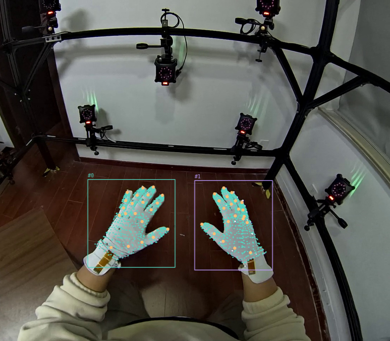
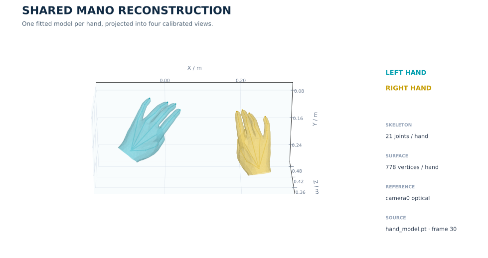
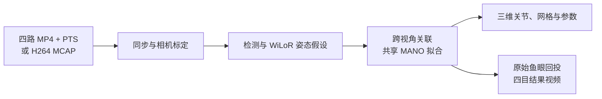

# EGO Hand System

[](https://github.com/zdh1213112/ego_hand_system/actions/workflows/ci.yml)


面向 **Orbbec EGO4 / EGO-4B 头戴相机**的手部三维重建系统，提供离线推理、实时跟踪、MANO 拟合、VIO 联动及训练标签生成。

四目共享推理支持 **MP4 + PTS 和 H264 MCAP**：每个同步时刻、每只手拟合一份 MANO 模型，并用原始标定回投到四路鱼眼画面。

[快速开始](#快速开始) · [输入与输出](#输入与输出) · [其他工作流](#其他工作流) · [验证记录](docs/INTEGRATION_VALIDATION_20261113.md)

## 真实结果



双手网格与关键点叠加展示。



四目共享推理的双手三维模型，直接从导出的 `hand_model.pt` 绘制。每只手包含 21 个关节和 778 个网格顶点，使用 camera0 光学参考系，长度单位为米。

上方三维模型图来自 `pair_20261111_192916` 的 60 帧验收片段；结果、数值对比及验证范围见[验收记录](docs/INTEGRATION_VALIDATION_20261113.md)。[双目结果和进阶流程](docs/ADVANCED_WORKFLOWS_zh.md#效果展示)另有完整说明。

## 功能概览

| 工作流 | 输入与能力 | 入口 / 文档 |
| --- | --- | --- |
| 四目共享 MANO 推理 | Orbbec 四路原图，跨视角关联、共享三维模型、四目视频与结果导出 | `scripts/run_hand_inference.sh` · [说明](docs/SHARED_HAND_INFERENCE_zh.md) |
| 双目离线重建 | Orbbec，MediaPipe、WiLoR、三角化、稳定化及 MANO 拟合 | `scripts/run_offline.sh` · [完整操作](docs/ADVANCED_WORKFLOWS_zh.md#离线启动) |
| Orbbec 四目融合 | KB 射线、多视角 WiLoR、RANSAC 与时序处理 | `scripts/run_multiview_wilor_experiment.sh` · [说明](docs/ADVANCED_WORKFLOWS_zh.md#四目多视角融合) |
| EGO + NOKOV 标签 | 原图对齐、双手 MANO 拟合、标签导出与验收 | `scripts/export_ego_nokov_labels.sh` · [命令清单](docs/EGO_NOKOV_NATIVE_LABEL_COMMANDS_zh.md) |
| 实时跟踪与 VIO | Orbbec 实时手部、Basalt 轨迹及多模态联动 | [实时使用](docs/EGO_REALTIME.md) · [世界轨迹](docs/BASALT_STEREO_INERTIAL_WORLD_TRAJECTORY.md) |
| 标签检查与查看 | 数据集检查、投影验证与可视化 | [标签查看器](docs/WILOR_LABEL_VIEWER_zh.md) · [数据交接约定](docs/MANO_GLOVE_LABEL_HANDOFF_zh.md) |

四目共享推理的处理流程：



## 快速开始

以下步骤运行四目共享推理。双目、四目、实时与标签生成见[其他工作流](#其他工作流)。

### 1. 获取代码和环境

需要 Linux、Conda、Git、FFmpeg，以及支持当前 PyTorch 运行时的 NVIDIA 驱动。

```bash
git clone https://github.com/zdh1213112/ego_hand_system.git
cd ego_hand_system
git submodule update --init third_party/MANO third_party/basalt third_party/WiLoR
bash scripts/setup_python_environment.sh
conda activate ego-hand
bash scripts/install_mediapipe_model.sh
```

安装脚本按项目固定版本准备 Python 3.10、CUDA PyTorch、OpenCV 和 WiLoR 依赖，并检查导入与版本兼容性。完整安装说明和问题处理见[进阶文档](docs/ADVANCED_WORKFLOWS_zh.md#一次性安装环境和公共依赖)。

### 2. 准备模型

WiLoR 公开模型文件来自 [Hugging Face 模型目录](https://huggingface.co/spaces/rolpotamias/WiLoR/tree/main/pretrained_models)。MANO 从 [MANO 项目页](https://mano.is.tue.mpg.de/)注册并按其许可下载。

```text
models/
├── wilor/
│   ├── detector.pt
│   ├── wilor_final.ckpt
│   └── model_config.yaml
└── mano/
    ├── MANO_RIGHT.pkl
    └── MANO_LEFT.pkl
```

新四目入口以 `MANO_RIGHT.pkl` 的 WiLoR 规范重建左右手；完整资产安装和原有流程的准备见[模型说明](models/README.md)。已有的授权 MANO 压缩包可以通过以下命令安装：

```bash
python scripts/install_mano_models.py --source /path/to/mano_v1_2.zip
python scripts/check_third_party.py --require-mano --require-wilor
```

手套录制可以使用自己的检测器，通过 `--detector /path/to/hand_detector.pt` 指定。

### 3. 运行四目共享推理

MP4 录制或分段目录：

```bash
bash scripts/run_hand_inference.sh \
  --input /path/to/recording/part0001 \
  --output output/shared_mp4
```

MCAP 文件或单分段录制目录：

```bash
bash scripts/run_hand_inference.sh \
  --input /path/to/recording/part0001/recording_part0001.mcap \
  --output output/shared_mcap
```

程序自动查找配套标定；需要手动指定时加 `--calibration /path/to/calibration.yaml`。每次录制使用独立输出目录。

默认 `--max-frames 0` 处理完整录制。先检查短片可加 `--max-frames 60`；本机验收使用的 FP16 批处理参数为：

```bash
bash scripts/run_hand_inference.sh \
  --input /path/to/recording/part0001 \
  --detector /path/to/hand_detector.pt \
  --gpu-profile rtx5090d --batch-size 16 --frame-batch-size 8 \
  --max-frames 60 \
  --output output/shared_preview
```

`compatible` 为默认 FP32 路径；`rtx5090d` 启用现有 FP16 路径。批大小按显存调整。可通过 `--conda-env NAME` 或 `EGO_HAND_PYTHON=/path/to/python` 选择已有环境，所有参数见：

```bash
bash scripts/run_hand_inference.sh --help
```

## 输入与输出

MP4 输入需要四路视频、各自的 PTS CSV 和匹配标定。支持录制根目录与单个 `part0001` 等分段；多分段分别运行。MCAP 需要四路 H264 相机 topic 和配套标定，详细目录与相机对应关系见[输入说明](docs/SHARED_HAND_INFERENCE_zh.md#安装与输入)。

四路帧默认以 camera0 时间戳同步，容差 1500 微秒，每路帧不复用。原始鱼眼图像保持原始像素空间，三维模型按各相机标定投影。

```text
OUTPUT/
├── final_shared_4view.mp4        # 四目结果视频
├── joints3d.jsonl               # 每时刻的三维骨架
├── hand_model.pt                # 网格、拓扑、MANO 参数与变换
├── observations_2d/camera*.jsonl # 各路检测与二维姿态假设
├── projections_2d.jsonl         # 共享模型的四路回投
├── calibration/                # 内外参及畸变
├── timestamps/                 # 源帧时间戳
├── multiview_frames.csv         # 四路同步映射
├── manifest.json               # 输入与标定溯源
├── source_meta.json             # 源录制元数据（存在时）
├── run_config.json              # 运行参数与模型、代码身份
├── video.json                   # 视频信息
└── summary.json                 # 完成状态与产物校验
```

三维单位为米，时间戳单位为纳秒，坐标系以标定参考系为准。没有有效共享模型的时刻保留空帧；当前每时刻最多一只左手和一只右手。字段与重建约定见[输出说明](docs/outputs.md)。

完整性校验成功后清理 `.cache/`。失败时保留已完成阶段；成功后同参数重跑会校验最终产物。输入、模型、代码或参数变化时使用新输出目录。

## 其他工作流

| 需求 | 使用文档 |
| --- | --- |
| 双目完整运行、分阶段执行、断点恢复、环境变量、C++ 构建 | [Orbbec 双目、四目与进阶工作流](docs/ADVANCED_WORKFLOWS_zh.md) |
| 原始数据生成 NOKOV/MANO 标签 | [流程说明](docs/EGO_NOKOV_NATIVE_LABEL_PIPELINE_zh.md) · [命令清单](docs/EGO_NOKOV_NATIVE_LABEL_COMMANDS_zh.md) |
| 多目训练标签导出 | [Orbbec 多目操作](docs/ADVANCED_WORKFLOWS_zh.md#训练标签导出) · [NOKOV 标签](docs/NOKOV_OPTICAL_MOCAP_TO_WILOR_LABELS.md) |
| Orbbec 实时与多模态联动 | [实时使用](docs/EGO_REALTIME.md) |
| Basalt 世界坐标轨迹 | [VIO 使用](docs/BASALT_STEREO_INERTIAL_WORLD_TRAJECTORY.md) |
| 原有 MANO 稳定化与 21-DOF 展示 | [稳定化](docs/MANO_MOTION_STABILITY_OPTIMIZATION_20260804.md) · [交互面板](docs/mano_21dof_dashboard_20260804.md) |
| 项目结构、算法结果、标签查看 | [目录说明](docs/REPOSITORY_CONTENTS.md) · [结果记录](docs/RESULTS.md) · [标签查看器](docs/WILOR_LABEL_VIEWER_zh.md) |

## 验证与来源

```bash
PYTHONPATH=scripts conda run -n ego-hand python -m pytest -q tests
```

移除 GEN 相机专用入口后，完整回归为 **305 passed, 1 skipped**，轻量 CI 为 **25 passed**；变更范围及真实 Orbbec 数据检查见[本次验证记录](docs/ORBBEC_ONLY_VALIDATION_20261113.md)。此前的干净克隆、MP4/MCAP 短片及固定输入数值对比见[融合验收记录](docs/INTEGRATION_VALIDATION_20261113.md)。不同工作流需要相应的模型、数据或硬件依赖。

基于 [WiLoR](https://github.com/Jzboom/WiLoR)、[MANO](https://mano.is.tue.mpg.de/) 和 [Basalt](https://github.com/VladyslavUsenko/basalt)。上游版本与资产信息见 [third_party/manifest.json](third_party/manifest.json)，使用时遵循各项目和模型的许可。
