# WiLoR 与多相机三维手部融合流程

本文档说明当前工程中 WiLoR 单相机推理与多相机三维融合两个阶段的职责、数据接口、几何方法、时序稳定逻辑和最终可视化门控。

文档对应的最新验证数据为：

```text
EGO_Pro_AZLR86000F7_20260917_170124
```

本次流程只使用 WiLoR，不使用手套 marker。

## 1. 核心职责

两个阶段的职责可以概括为：

- WiLoR 阶段回答：每个相机图像中，手的检测框和 21 个关节分别落在哪些像素上；
- 多相机融合阶段回答：不同相机中的观测是否属于同一只物理手，以及这只手在公共三维坐标系中的真实位置；
- 时序与解剖稳定阶段回答：当前三维结果是否出现深度跳变、身份交换、关节尖峰或不合理骨长；
- 最终显示门控回答：这个三维结果是否足够可信，可以重新投影并显示在某个相机画面上。

```mermaid
flowchart LR
    A["四相机同步帧"] --> B["手部 detector<br/>框、置信度、左右手标签"]
    B --> C["每个框生成<br/>左手与右手两种 WiLoR 假设"]
    C --> D["每种假设输出<br/>21 个原图二维关节"]
    D --> E["按 sync_index 汇合四相机结果"]
    E --> F["枚举相机组合和物理手候选"]
    F --> G["KB 像素反投影为三维射线"]
    G --> H["逐关节 RANSAC 三角化"]
    H --> I["重投影、深度和解剖质量评分"]
    I --> J["选择左右手和最佳三维分支"]
    J --> K["身份、深度、骨长和时序稳定"]
    K --> L["最终三维手与安全投影视图"]
```



## 2. 输入数据与相机标定

### 2.1 同步图像

归一化数据集包含：

```text
normalized_multiview/
├── cameras/
│   ├── camera0/video.mkv
│   ├── camera1/video.mkv
│   ├── camera2/video.mkv
│   └── camera3/video.mkv
├── calibration/
│   ├── camera0.json
│   ├── camera1.json
│   ├── camera2.json
│   └── camera3.json
├── multiview_frames.csv
└── manifest.json
```

`multiview_frames.csv` 使用 `sync_index` 将四路图像对齐。最新数据共有 618 组同步帧，同步绝对误差为：

- 中位数：3 μs；
- P95：7 μs；
- 最大值：12 μs。

### 2.2 标定参数

每个相机 JSON 包含：

- `image_size`：1600 × 1200；
- `model`：KB 鱼眼模型；
- `K`：相机内参矩阵；
- `distortion`：`k1..k4` 鱼眼畸变参数；
- `T_base_camera`：相机坐标系到公共 base 坐标系的刚体变换。

`camera0` 是公共基准坐标系。

最新 `170124.mcap` 中没有 calibration 或 `camera_info` topic，因此当前标定来自同一设备序列号 `AZLR86000F7` 的外部工厂标定：

```text
EGO_Pro_AZLR86000F7_20260917_165710_calibration_camera.yaml
```

MCAP 中包含四路相机、IMU 和音频消息，但当前手部流程只解码四路相机和时间戳。

## 3. 阶段一：单相机 detector 与 WiLoR 推理

主要实现：

```text
scripts/wilor_multiview_inference.py
```

这个阶段分别处理每个相机，不使用相机外参，也不直接访问其他相机结果。

### 3.1 手部 detector

当前默认 detector 为：

```text
models/wilor/best.pt
```

类别必须严格为：

```text
0 = left
1 = right
```

程序会验证类别定义，并在 `summary.json` 中保存：

- detector 绝对路径；
- SHA-256；
- 类别名称。

最新运行使用的权重 SHA-256 为：

```text
f91c32b1a5a3303a4aacd2b8dbfda1f17888f2925196ab375c3ee87e01f8f2a1
```

每个检测框包含：

```text
bbox_xyxy
confidence
detector_is_right
```

最新运行在四个相机上均使用 `0.5` 置信度门限。

### 3.2 为什么每个框要生成两个 WiLoR 假设

单帧 detector 的左右手标签会在侧视、遮挡、交叉和重新入场时发生翻转。因此代码不会立即把 detector 标签当作物理身份，而是对每个框建立两个假设：

```text
同一个检测框
├── is_right = 0：按左手模型解释
└── is_right = 1：按右手模型解释
```

如果一帧检测出两个物理框，WiLoR 输出通常包含四条假设：

```text
检测框 0 × 左右手两种假设
检测框 1 × 左右手两种假设
```

`detection_index` 用于标记两个假设来自同一个检测框。后续融合不得把同一检测框的两个假设当成两只物理手。

### 3.3 WiLoR 裁剪与推理

对于每个假设，WiLoR 执行：

1. 根据检测框中心和尺寸建立手部裁剪；
2. 按 `rescale_factor` 扩展上下文区域；
3. 缩放并归一化为网络输入；
4. 预测规范坐标中的手部结构和 `pred_cam`；
5. 根据左右手假设镜像 X 坐标；
6. 将裁剪坐标中的相机参数换算到完整图像；
7. 把 21 个关节投影回原始 1600 × 1200 图像。

右手镜像的核心形式为：

```python
joints3d[:, 0] *= 2 * is_right - 1
```

随后使用 `cam_crop_to_full` 和网络使用的等效焦距，将关节投影回完整图像。

### 3.4 WiLoR 阶段输出

每个相机输出一个 `predictions.jsonl`。每个同步帧的结构为：

```json
{
  "sync_index": 0,
  "source_frame_index": 0,
  "timestamp_ns": 0,
  "hands": [
    {
      "detection_index": 0,
      "hypothesis_index": 0,
      "bbox_xyxy": [0, 0, 0, 0],
      "confidence": 0.99,
      "detector_is_right": 0,
      "is_right": 0,
      "camera_translation": [0, 0, 0],
      "joints_2d": [[0, 0]]
    }
  ]
}
```

其中 `joints_2d` 实际包含 21 个原始图像像素坐标。

### 3.5 单目三维为什么不直接交给融合

WiLoR 内部会预测规范坐标三维关节，但当前多相机融合不会把该单目三维结果直接当成公制三维。

原因是单目预测存在尺度与绝对深度歧义。`camera_translation` 是 WiLoR 网络投影模型中的参数，不是四相机公共 base 坐标系中的真实相机位姿。

因此两个阶段的核心接口是：

```text
WiLoR joints_2d + 四相机标定
```

而不是：

```text
WiLoR 单目三维的直接平均
```

最终以米为单位的三维关节 `joints_base_m` 由多相机射线重新三角化得到。

### 3.6 GPU 使用范围

最新运行使用 RTX 5060 Laptop GPU 和 CUDA FP32。GPU 负责：

- detector 推理；
- WiLoR 网络推理。

几何候选枚举、RANSAC、时序和解剖稳定主要运行在 CPU。最新融合使用 4 个 worker 并行处理单帧候选。

## 4. 两阶段之间的数据接口

多相机融合使用 `sync_index` 对齐四路 `predictions.jsonl`。

| WiLoR 字段 | 融合中的作用 |
|---|---|
| `sync_index` | 对齐四个相机的同一时刻 |
| `source_frame_index` | 追溯原始视频帧 |
| `timestamp_ns` | 记录原始采集时间 |
| `detection_index` | 识别同一框产生的左右手双假设 |
| `hypothesis_index` | 区分当前相机中的 WiLoR 推理项 |
| `bbox_xyxy` | 重复手判断、最终显示和投影范围门控 |
| `confidence` | 候选排序和诊断 |
| `detector_is_right` | 左右手软提示，不是最终身份 |
| `is_right` | 当前 WiLoR 假设方向 |
| `joints_2d` | 三角化和跨相机关联的主要几何观测 |
| `camera_translation` | 保留单目投影诊断，不作为公制融合位置 |

必须特别区分：

- `detector_is_right`：detector 对单帧图像的分类；
- `is_right`：当前 WiLoR 假设使用的模型方向；
- 融合输出 `side`：跨相机、跨帧稳定后的物理手轨迹身份。

这三个字段可能不同。

## 5. 阶段二：多相机三维融合

主要实现：

```text
scripts/fuse_multiview_wilor.py
scripts/fuse_multiview_wilor_guided.py
```

### 5.1 将鱼眼像素变成公共坐标系射线

对相机中的关节像素 `p = (u,v)`，首先使用 KB 模型和内参、畸变参数进行反投影：

```text
(u,v) --KB unproject--> 相机坐标系单位射线 d_camera
```

再使用 `T_base_camera` 转换到公共 base 坐标系：

```text
C_base = T_base_camera 的平移部分
d_base = R_base_camera · d_camera
```

每个二维关节观测最终表示为空间射线：

```text
X(λ) = C_base + λ d_base
```

### 5.2 独立生成每只物理手的候选

融合会分别枚举物理手 0 和物理手 1 的候选，而不是一开始强制两只手同时存在。

候选包含：

- 使用了哪些相机；
- 每个相机使用哪个 `detection_index`；
- 每个相机选择左手还是右手 WiLoR 假设；
- 21 个三维关节；
- 每个关节的内点相机数量；
- 重投影误差；
- 深度条件；
- 解剖代价；
- 候选总代价。

如果只有一只手可靠，系统只输出一只手，不会为了凑齐两只手而生成错误结果。

### 5.3 anchor 相机对

当前优先 anchor 为：

```text
camera2 + camera3
```

两者物理基线约为 170 mm，比 `camera0 + camera1` 约 100 mm 的基线更宽，通常具有更好的深度可观测性。

代码仍会枚举所有有观测的相机对：

```text
camera0 + camera1
camera0 + camera2
camera0 + camera3
camera1 + camera2
camera1 + camera3
camera2 + camera3
```

非首选 anchor 只增加一个较小代价。当首选相机不可见或遮挡时，其他组合仍然可以胜出。

### 5.4 初始 anchor 三角化

对关节 `j`，从两个 anchor 相机获得两条射线。射线交点通过最小二乘求解：

```text
X* = argmin_X Σ ||(I - d dᵀ)(X - C)||²
```

初始 anchor 阶段使用较宽松的约 60 px 门限，目的是生成跨相机关联参考，而不是直接生成最终结果。

如果射线近平行、方程病态、交点太靠近相机或者距离公共坐标原点过远，该关节会被拒绝。

### 5.5 关联其余相机

初始三维手会投影到其余相机。对每个相机的所有 WiLoR 候选，计算预测投影与候选 `joints_2d` 的误差。

当前跨相机关联门限约为 55 px。只有误差达标的候选才会作为同一只物理手的额外观测。

因此跨相机关联不是比较 `detection_index`，因为每个相机的检测编号互不相关。真正的关联依据是：

```text
三维参考投影与二维关节是否一致
```

### 5.6 最终逐关节 RANSAC 三角化

关联额外相机后，对每个关节重新进行多视角 RANSAC。

假设一个关节有四个相机观测，RANSAC 会枚举所有两相机组合：

```text
0+1, 0+2, 0+3, 1+2, 1+3, 2+3
```

每个组合生成一个三维交点，并将其投影回所有相机。最终优先选择：

1. 内点相机数量最多；
2. 内点重投影中位数最小；
3. 射线夹角更大、深度条件更好。

最终 RANSAC 重投影门限约为 20 px。得到内点集合后，再用全部内点射线重新求解三维点。

### 5.7 为什么低重投影误差仍可能深度错误

两条近平行射线可能在很远的位置相交。这个错误交点重新投影回原来的两个相机时，像素误差仍然可能很低。

因此融合同时检查：

- anchor 物理基线；
- 射线夹角；
- 五个掌根关节的三视图支持数量；
- 两视图关节占比；
- 不同相机对三角化点的空间分散程度；
- 手掌宽度；
- 三维手与相机中心的距离；
- 整只手的空间半径。

深度质量分为：

- `normal`：可作为稳定轨迹和另一只手的可靠参考；
- `weak`：可以保留为单手观测，但不能无条件绑定另一只手；
- `unsafe`：不允许进入最终结果。

### 5.8 候选代价

候选代价综合：

```text
缺失关节惩罚
+ 重投影中位数
+ 重投影 P95
+ 全部视图误差
+ 几何异常关节惩罚
+ 两视图弱支持惩罚
+ 深度条件惩罚
+ 不合理骨段长度惩罚
+ 短基线惩罚
- 多相机额外支持奖励
```

因此系统不会简单选择重投影误差最低的分支，而是选择图像一致、深度稳定、关节完整、骨架合理并且相机支持更多的分支。

### 5.9 防止一只手被重复当成两只手

由于每个 detector 框会产生左右手两个 WiLoR 假设，融合必须显式禁止：

- 同一个 `(camera, detection_index)` 被两只物理手重复使用；
- 两个候选在多个相机中具有高度重叠框；
- 两只三维手中心近乎重合；
- 一个弱深度候选把另一个可靠候选绑定到错误分支。

如果两手组合不安全，系统保留质量更好的单手结果。

## 6. 跨帧身份与三维轨迹稳定

单帧融合完成后，系统继续对整个序列执行：

1. 三维左右手身份稳定；
2. 轨迹连续性重新选择候选分支；
3. 使用共享相机二维轨迹再次确认身份；
4. 标记真实离场和重新入场边界；
5. 填补很短的缺失手轨迹；
6. 对低支持深度进行有界正则化；
7. 进入解剖和时序稳定。

最终 `side=0/1` 表示持续的物理手轨迹身份，不等同于任意单帧的 detector 标签。

最新结果中：

- detector 标签与最终身份不一致的选中视图数：538；
- 轨迹连续性重新选分支帧数：5；
- 短缺失身份填充数：35；
- 低支持深度正则化手数：5。

这些变化说明自适应身份和分支选择在实际序列中确实被使用。

## 7. 解剖与时序稳定

主要实现：

```text
scripts/fusion_anatomy_refinement.py
```

输入是每一帧已经完成多相机融合的 `joints_base_m`。

### 7.1 离群观测和骨长估计

系统首先检测：

- 关节相对于短时间窗口的三维离群；
- 整只手半径异常；
- 骨段绝对长度异常；
- 骨段相对稳定长度偏差过大。

然后从可靠观测估计每只物理手的稳定骨长。

### 7.2 短缺失与刚体邻帧恢复

短时间缺失关节可以从前后可靠帧插值。对于存在足够掌根锚点的邻帧，可以先进行刚体对齐，再恢复缺失关节。

这种恢复用于短间隙，不会跨越已标记的离场/重入边界。

### 7.3 骨长和掌心局部坐标平滑

候选手型经过：

- 固定骨长约束；
- 掌心局部坐标系中的手指形状平滑；
- 再次骨长约束；
- 掌心刚体姿态恢复。

可靠原始观测不会被候选完全覆盖，只允许以较小权重和最大位移上限向候选靠近。

### 7.4 每次修正后的重投影保护

三维修正后，系统会把新关节重新投影到原始相机，并与融合阶段保留的 `joints_2d` 比较。

如果修正导致：

- 重投影误差明显恶化；
- 图像位移超过上限；
- 只有部分手掌通过而导致掌心和手指落在不同深度分支；

系统会限制修正或者恢复原始多相机结果。

因此时序和平滑是次级约束，多相机图像观测始终是主证据。

### 7.5 最终异常保护顺序

当前依次执行：

```text
原始多相机三维
  ↓
离群点拒绝与短间隙稳定
  ↓
骨长和掌心局部形状候选
  ↓
重投影保护
  ↓
稳健时序修复
  ↓
置信度引导的双向跟踪
  ↓
整手掌轨迹尖峰保护
  ↓
单关节尖峰保护
  ↓
短窗口末端尖峰过滤
  ↓
小幅零相位手势平滑
  ↓
再次重投影保护
  ↓
最大位移和整手原子性保护
  ↓
最终物理手型包络检查
```

如果一组局部修正使整手变得不连续，会整手恢复，而不是留下部分关节在旧深度、部分关节在新深度的混合骨架。

## 8. 融合输出结构

最终 `accepted.jsonl` 中，每只手包含：

```json
{
  "side": 0,
  "camera_ids": ["camera0", "camera1", "camera2", "camera3"],
  "joints_base_m": [[0, 0, 0]],
  "inlier_view_counts": [4],
  "quality": {
    "valid_joint_count": 21,
    "multiview_reprojection_median_px": 3.34,
    "multiview_reprojection_p95_px": 12.09,
    "palm_ray_angle_p25_deg": 19.40,
    "palm_three_view_count": 5
  },
  "views": {
    "camera0": {
      "detection_index": 0,
      "bbox_xyxy": [0, 0, 0, 0],
      "confidence": 0.99,
      "detector_is_right": 0,
      "joints_2d": [[0, 0]],
      "inlier_joint_count": 21
    }
  },
  "unrefined_joints_base_m": [[0, 0, 0]],
  "anatomy_refinement": {
    "applied": true,
    "corrected_joint_count": 0
  }
}
```

其中：

- `joints_base_m`：最终稳定后的公共坐标系三维关节，单位米；
- `unrefined_joints_base_m`：进入解剖稳定前的多相机三角化结果；
- `inlier_view_counts`：每个关节由多少个相机内点支持；
- `views`：生成该三维手时实际选中的相机二维观测；
- `quality`：重投影、射线夹角、相机对分散和支持度诊断；
- `anatomy_refinement`：时序与解剖阶段对该帧做过的修改。

## 9. 最终视频安全门控

主要实现：

```text
scripts/render_multiview_wilor.py
```

稳定后的三维手会重新投影到每个相机，但只有满足以下条件才显示：

- 该相机确实参与过这只手的融合；
- 至少 12 个内点关节；
- 至少 18 个有效三维和二维比较关节；
- 投影与 WiLoR 二维观测的残差中位数不超过 25 px；
- 残差 P95 不超过 50 px；
- 至少 85% 的投影关节位于 detector 框加 10% padding 的范围内。

不满足条件的相机视角直接不画。这个策略用于避免：

- 骨架投影到画面外；
- 骨架落在显示器等误检目标上；
- 局部可见关节被错误连成长线；
- 三维稳定结果与当前二维观测明显冲突。

## 10. 最新 `170124` 结果

最新输出目录：

```text
output/20260917/EGO_Pro_AZLR86000F7_20260917_170124_cpu/
```

虽然父目录名保留 `_cpu`，本次 `wilor_multiview_best_gpu` 确实使用 CUDA GPU 完成 detector 和 WiLoR 推理。

### 10.1 WiLoR 输出

```text
wilor_multiview_best_gpu/
```

各相机 detector 统计：

| 相机 | 检出帧 | 物理框数 |
|---|---:|---:|
| camera0 | 605 / 618 | 1099 |
| camera1 | 613 / 618 | 1144 |
| camera2 | 592 / 618 | 964 |
| camera3 | 601 / 618 | 1086 |

### 10.2 融合输出

```text
fusion_multiview_wilor_best_gpu_v1/
```

主要指标：

| 指标 | 结果 |
|---|---:|
| 接受帧 | 618 / 618 |
| 融合手实例 | 1219 |
| 多视角手实例 | 1117 |
| 多视角手比例 | 91.63% |
| 选中视图数量中位数 | 3 |
| 有效关节内点视图数中位数 | 3 |
| 融合重投影中位数 | 3.482 px |
| 手掌帧间位移中位数 | 5.95 mm |
| 手掌帧间位移 P95 | 31.12 mm |
| 手掌最大帧间位移 | 67.24 mm |

最终视频安全门控产生 3274 个相机-手叠加：

- 617 / 618 帧至少显示一个安全手部结果；
- 555 帧至少显示四个安全相机-手结果；
- 不可靠视图主要因为没有被融合选中、P95 残差过大、投影超出检测框或支持不足而不显示。

### 10.3 结果文件

```text
fusion_multiview_wilor_best_gpu_v1/accepted.jsonl
fusion_multiview_wilor_best_gpu_v1/rejected.jsonl
fusion_multiview_wilor_best_gpu_v1/summary.json
fusion_multiview_wilor_best_gpu_v1/final_only_4view.mp4
fusion_multiview_wilor_best_gpu_v1/diagnostic_4view.mp4
```

## 11. 典型错误如何在两个阶段间传播

### 11.1 detector 框错误

```text
显示器被 detector 当成手
  ↓
WiLoR 在错误裁剪框内拟合出一个合理手型
  ↓
输出错误位置的 joints_2d
  ↓
如果多个相机出现相关误检，融合可能找到一个错误三维分支
```

这是旧结果中框和骨架落到显示器上的主要原因。更换 `best.pt` 后，真实灰色手套框成为主要输入，融合质量随之显著改善。

### 11.2 单相机左右手标签错误

```text
detector_is_right 翻转
  ↓
左右手双 WiLoR 假设仍然保留正确分支
  ↓
多相机几何选择更一致的假设
  ↓
跨帧身份跟踪写入最终 side
```

因此 detector 标签翻转通常可以被后续阶段纠正。

### 11.3 两相机深度歧义

```text
两个视图像素拟合良好
  ↓
射线夹角太小或相机对结果分散
  ↓
重投影误差低，但深度可能跳变
  ↓
depth condition 判为 weak 或 unsafe
  ↓
选择宽基线/多视图分支，或只保留单手，或直接拒绝
```

### 11.4 时序修正过强

```text
平滑候选偏离真实图像观测
  ↓
重新投影到原相机
  ↓
残差或图像位移超过门限
  ↓
限制修正或恢复原始多相机三角化
```

## 12. 代码索引

| 功能 | 文件与入口 |
|---|---|
| WiLoR 单帧左右手双假设 | `scripts/wilor_multiview_inference.py::infer_dual` |
| WiLoR 跨帧 GPU 批处理 | `scripts/wilor_multiview_inference.py::infer_dual_batched` |
| 像素射线和 RANSAC 三角化 | `scripts/fuse_multiview_wilor.py::triangulate_ransac` |
| 21 关节整手三角化 | `scripts/fuse_multiview_wilor.py::_triangulate_hand` |
| 融合手序列化 | `scripts/fuse_multiview_wilor.py::_serialize_hand` |
| 单只物理手候选枚举 | `scripts/fuse_multiview_wilor_guided.py::_single_side_candidates` |
| 单帧双手/单手独立选择 | `scripts/fuse_multiview_wilor_guided.py::_independent_frame_fusion` |
| 跨帧主融合流程 | `scripts/fuse_multiview_wilor_guided.py::main` |
| 解剖和时序稳定 | `scripts/fusion_anatomy_refinement.py::refine_accepted_rows` |
| 最终投影安全门控 | `scripts/render_multiview_wilor.py::_final_overlay_for_view` |

## 13. 职责边界总结

| 阶段 | 主要解决的问题 | 无法单独解决的问题 |
|---|---|---|
| detector + WiLoR | 手框、单相机手型、21 个二维关节 | 真实公制深度、跨相机身份、长期稳定 |
| 多相机融合 | 公制三维、跨相机关联、深度、候选选择 | 所有相机都持续错误时凭空恢复真实手 |
| 时序与解剖稳定 | 短时跳变、骨长变化、关节尖峰、身份连续性 | 长时间完全不可见或持续错误观测 |
| 最终显示门控 | 不显示不可信的框和骨架 | 不能增加新的图像观测信息 |

整个流程的基本原则是：

> detector 决定看哪里，WiLoR 决定图像中的关节形状，多相机标定和三角化决定公制三维位置，时序与解剖约束只对三维结果做有界修复，最终门控决定是否可以安全显示。
