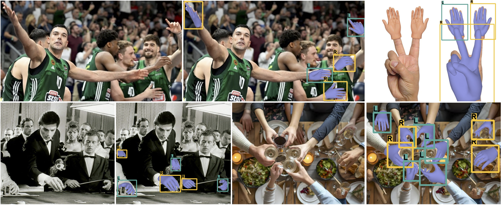

<div align="center">

# WiLoR: End-to-end 3D hand localization and reconstruction in-the-wild

[Rolandos Alexandros Potamias](https://rolpotamias.github.io)<sup>1</sup> &emsp; [Jinglei Zhang]()<sup>2</sup> &emsp; [Jiankang Deng](https://jiankangdeng.github.io/)<sup>1</sup> &emsp; [Stefanos Zafeiriou](https://www.imperial.ac.uk/people/s.zafeiriou)<sup>1</sup>  

<sup>1</sup>Imperial College London, UK <br>
<sup>2</sup>Shanghai Jiao Tong University, China

<font color="blue"><strong>CVPR 2025</strong></font> 

<a href='https://rolpotamias.github.io/WiLoR/'></a>
<a href='https://arxiv.org/abs/2409.12259'></a>
<a href='https://huggingface.co/spaces/rolpotamias/WiLoR'></a>
<a href='https://colab.research.google.com/drive/1bNnYFECmJbbvCNZAKtQcxJGxf0DZppsB?usp=sharing'></a>
</div>

<div align="center">

[](https://paperswithcode.com/sota/3d-hand-pose-estimation-on-freihand?p=wilor-end-to-end-3d-hand-localization-and)
[](https://paperswithcode.com/sota/3d-hand-pose-estimation-on-ho-3d?p=wilor-end-to-end-3d-hand-localization-and)

</div>

This is the official implementation of **[WiLoR](https://rolpotamias.github.io/WiLoR/)**, an state-of-the-art hand localization and reconstruction model:



### 🚀 News: WiLoR can run even faster! 🚀
✅ WiLoR demo now supports half precision inference and depth prunning, resulting in up to **1.6x** faster inferece with minimal performance degradation (~Δ-MPJPE 0.05mm). Simply run demo using `--fast` argument. 
```bash
python demo.py --img_folder demo_img --out_folder demo_out --save_mesh  --fast
```
## Installation
### Original Installation
```
git clone --recursive https://github.com/rolpotamias/WiLoR.git
cd WiLoR
```

The code has been tested with PyTorch 2.0.0 and CUDA 11.7. It is suggested to use an anaconda environment to install the the required dependencies:
```bash
conda create --name wilor python=3.10
conda activate wilor

pip install torch torchvision --index-url https://download.pytorch.org/whl/cu117
# Install requirements
pip install -r requirements.txt
```
Download the pretrained models using: 
```bash
wget https://huggingface.co/spaces/rolpotamias/WiLoR/resolve/main/pretrained_models/detector.pt -P ./pretrained_models/
wget https://huggingface.co/spaces/rolpotamias/WiLoR/resolve/main/pretrained_models/wilor_final.ckpt -P ./pretrained_models/
```
It is also required to download MANO model from [MANO website](https://mano.is.tue.mpg.de). 
Create an account by clicking Sign Up and download the models (mano_v*_*.zip). Unzip and place the right hand model `MANO_RIGHT.pkl` under the `mano_data/` folder. 
Note that MANO model falls under the [MANO license](https://mano.is.tue.mpg.de/license.html).

### Quick Installation
Thanks to [@warmshao](https://github.com/warmshao) WiLoR can now be installed using a single pip command:  
```
pip install git+https://github.com/warmshao/WiLoR-mini
```
Please head to [WiLoR-mini](https://github.com/warmshao/WiLoR-mini) for additional details. 

**Note:** the above code is a simplified version of WiLoR and can be used for demo only. 

## Demo
```bash
python demo.py --img_folder demo_img --out_folder demo_out --save_mesh --fast
```
**[🚀 Update March 2026]**: Use argument `--fast` for up to **1.6** faster inference.  

## Video inference

Run WiLoR recursively on all videos under a directory:

```bash
python video_demo.py \
  --input /path/to/cameras \
  --mano-path /path/to/mano_v1_2 \
  --output output/video_results
```

The script writes an annotated MP4 and a per-frame JSONL prediction file for
each input video. The default MP4 overlays WiLoR's 21 hand keypoints and their
bone connections; use `--render-mesh` to additionally overlay the MANO mesh.
Use `--max-frames 10` for a quick check, `--no-render` for detector boxes
without keypoint/mesh overlays, or `--save-meshes` to export reconstructed OBJ
files.

## 3D annotation preview videos

使用 `ego-hand` 环境，直接将现有数据集标注导出为左侧原始 RGB、右侧 3D
关节点和骨架的对照视频，无需运行 WiLoR 或加载 MANO 模型：

```bash
# 默认处理 0826_400_has_out_scene_2D、0827_sl、0905_jhn，每套一个 MP4
conda run --no-capture-output -n ego-hand python visualize_hand_3d.py

# 指定单套数据集，先预览前 30 个 RGB 帧
conda run --no-capture-output -n ego-hand python visualize_hand_3d.py \
  --dataset-root datasets/0905_jhn/dataset \
  --output-dir output/hand_3d_preview --max-frames 30

# 在 RGB 上同时绘制 GT 框和 2D 投影，右侧显示手腕相对 3D
conda run --no-capture-output -n ego-hand python visualize_hand_3d.py \
  --dataset-root /path/to/dataset \
  --output-dir /path/to/video_visualization \
  --overlay-2d --coordinate-mode root-relative
```

默认输出 `output/hand_3d_videos/<数据集名>_rgb_3d.mp4`，1280×720、10 FPS。
视频使用 H.264（`libx264`）编码、`yuv420p` 像素格式和 MP4 faststart，支持 VS Code 内置播放。
可通过 `--fps`、`--width`、`--height` 调整。只写视频，不保存逐帧图片；
成功完成后替换同名视频。按录制来源、相机分段，段内按原始帧号排序并合并同帧双手；
`--max-frames` 限制每套数据集选取的帧组数，无法读取的 RGB 不写入视频。
这是按标注帧播放的预览，FPS 不代表原视频速度。

右侧使用 `joints_3d + trans` 保留相机空间中的双手位置，左手蓝色、右手橙色。
使用 `--coordinate-mode root-relative` 时会减去各手腕坐标并固定左右手锚点，便于和
预测结果比较；`--overlay-2d` 使用标签中的 `K` 和相机空间 3D 关节，在左侧绘制
GT 框、21 个关节及骨架。
为便于观察，将相机 X 显示为横轴、Z 显示为深度轴、-Y 显示为向上轴，单位为米；
每段固定视角和等比例坐标范围，不逐帧缩放，不应用训练时的镜像或裁剪。
缺失或异常标签跳过对应手，无有效手时显示提示；缺失 RGB 跳过帧，并在终端报告统计。
OpenTouch 缺少 RGB 相机对齐标注，本脚本不支持其训练清单。

依赖 NumPy、OpenCV、Matplotlib、支持 `libx264` 的 PyAV；现有 NPY 标签含 PyTorch 张量，反序列化还需要
PyTorch，`ego-hand` 环境已具备这些依赖。仅对可信本地数据使用 NPY pickle 加载。

## GT / trained prediction comparison

使用训练目录下已有的 `val_visualization/predictions.jsonl`，生成左侧原始 RGB、
右侧 GT（绿色实线）与训练预测（红色虚线）叠加的 3D 对比视频：

```bash
conda run --no-capture-output -n ego-hand python visualize_hand_comparison.py \
  --run-dir output/0905_jhn_stage2_pretrained
```

默认从训练目录的 `resolved_config.yaml` 获取数据集路径，输出到
`<run-dir>/comparison_visualization/`：H.264 视频 `rgb_gt_pred_3d.mp4`、
一张示例图 `rgb_gt_pred_example.png` 和 `comparison_report.json`。
默认 1600×900、10 FPS；支持 `--dataset-root`、`--predictions`、`--output-dir`、
`--max-frames`、`--fps`、`--width`、`--height`；`--no-example-image` 可关闭示例图。
示例优先选择双手帧，再选择帧平均 MPJPE 最接近整体帧中位数的一帧。

对比严格按样本 ID、录制来源、相机、帧号和手别匹配，校验已有 GT 与标签一致，
仅展示已有预测的手，不对未预测的训练样本补画结果。左手恢复训练前的 X 轴方向。
由于保存的是手腕相对坐标，预测和 GT 都放在 **GT 手腕位置**，用于比较手指姿态；
这不代表模型预测的绝对空间位置，也不使用裁剪相机的 `pred_cam_t` 充当完整相机平移。
两者使用相同视角及每段固定的等比例坐标范围；画面显示重新计算的手腕相对 MPJPE。
此命令复用已有验证预测，不重新加载权重或推理；依赖与标注可视化相同，另需 PyYAML。

## MCAP video prediction preview

对 GEN MCAP 的 `camera2` 直接运行手部检测和微调后的 WiLoR，输出左侧相机画面、
右侧预测 3D 骨架的 H.264 视频。左侧直接叠加 YOLO 左右手检测框，以及 WiLoR 3D
关节点投影得到的 2D 骨架和检测置信度：

```bash
conda run --no-capture-output -n ego-hand python mcap_video_demo.py \
  --input /path/to/recording.mcap
```

默认使用 `pretrained_models/best.pt`（类别 `left/right`）检测手框，使用
`pretrained_models/wilor_final.ckpt` 加载基础模型，再加载
`output/0905_jhn_stage2_pretrained/best_adapter.pt`。默认相机为训练数据对应的
`camera2`；可用 `--camera cameraN`、`--detector`、`--adapter` 和 `--output-dir`
覆盖。传入 `--no-adapter` 可仅使用原始 `wilor_final.ckpt`，用于和微调结果对照。
`--adapter` 同时支持 schema-v3 训练输出的 `best_trainable.pt`（包含 LoRA 或全量 ViT
权重）；可用 `--model-label` 设置视频中的模型名称。
每个左右手类别只保留置信度最高的框，`--max-detections-per-class 0` 可关闭限制。
若同一类别有两只可见手，可设 `--max-detections-per-class 2`。重复类别的手腕在
3D 视图中按图像位置分开放置，YOLO 的原始类别和颜色保持不变。

输出目录包含 `*_pred_3d.mp4`、逐帧预测 JSONL 和 `run_report.json`，不保存逐帧图片。
视频帧率根据 MCAP 时间戳估计，可用 `--fps` 覆盖；`--max-frames` 可先做短片检查。
默认将每只手以手腕为原点，并放到固定的左右位置，稳定展示手势。单目弱透视相机的
绝对深度不是可靠的米制距离；如需检查该原始输出，可传 `--coordinate-mode camera`。
MCAP 会读取两遍：第一遍推理并确定全片固定的 3D 范围，第二遍只解码和渲染，
不会重复模型推理。该入口依赖 `ego-hand` 环境中的 PyAV、MCAP 和 MCAP Protobuf。
已有 JSONL 时可用 `--reuse-predictions` 只重新渲染。

基础与微调模型分别运行后，可复用两个输出目录的 JSONL 合成同步对比视频：

```bash
conda run --no-capture-output -n ego-hand python visualize_mcap_comparison.py \
  --input /path/to/recording.mcap \
  --base-dir /path/to/base_output \
  --finetuned-dir /path/to/finetuned_output \
  --output-dir /path/to/comparison_output
```

左列为基础模型、右列为微调模型，上排为 RGB 检测框和 2D 骨架，下排为手腕相对
3D 骨架。脚本检查两次推理的帧号、时间戳、检测框、类别和置信度一致，两个 3D
视图使用共同的固定坐标范围。默认输出 1600×1200 H.264 MP4 和比较报告，
不重复推理，不保存逐帧图片。
两列标题优先使用各自运行报告中的 `model_label`，也可用 `--base-label` 和
`--finetuned-label` 显式指定。两个目录均可为训练后的模型；比较任意两组预测时，
可使用等价参数 `--left-dir`、`--right-dir`、`--left-label`、`--right-label`。
`--output-name comparison.mp4` 可指定视频文件名，并保存同名的
`comparison_report.json`，方便在一个目录内保存多组对比。

## Fused multiview GT preview

将六相机融合输出的 `fusion_multiview/joints_base_m` 与 `camera2` 原始画面可视化：

```bash
conda run --no-capture-output -n ego-hand python visualize_fused_gt.py \
  --input /path/to/gen6_batch_or_single_run
```

左侧使用原生 Double-Sphere 标定投影融合 GT，并显示来源检测框；右侧先把基座坐标
转换到目标相机轴，再以手腕为原点、按左右手固定位置显示 3D 骨架。视频保留全部同步
帧；融合拒绝帧显示拒绝原因，不会从时间轴移除。默认输出到
`<run>/fusion_multiview/gt_visualization/camera2_rgb_fused_gt_3d.mp4`，H.264 编码，
不保存逐帧图片。支持 `--camera`、`--output-dir`、`--max-frames`、`--fps` 和画面尺寸参数。

## Glove fine-tuning

The repository has one unified glove-training entry point with two recipes.
Stage 1 adapts all ViT blocks to OpenTouch glove imagery through LoRA and a
palm-local relative-pose loss; it does not use RGB camera alignment or
RefineNet. Stage 2 uses camera-aligned user data and the full WiLoR geometry
path. See [GLOVE_TRAINING.md](GLOVE_TRAINING.md) for the bbox contract,
commands, checkpoint behavior, losses, and validation.
The glove dataset validator needs both `MANO_LEFT.pkl` and `MANO_RIGHT.pkl`
when replaying native side-specific labels. A fully right-canonical dataset
only requires `MANO_RIGHT.pkl`, which is also the model used by WiLoR itself.

## Start a local gradio demo
You can start a local demo for inference by running:
```bash
python gradio_demo.py
```
## WHIM Dataset
To download WHIM dataset please follow the instructions [here](./whim/Dataset_instructions.md)

## Acknowledgements
Parts of the code are taken or adapted from the following repos:
- [HaMeR](https://github.com/geopavlakos/hamer/)
- [Ultralytics](https://github.com/ultralytics/ultralytics)

## License 
WiLoR models fall under the [CC-BY-NC--ND License](./license.txt). This repository depends also on [Ultralytics library](https://github.com/ultralytics/ultralytics) and [MANO Model](https://mano.is.tue.mpg.de/license.html), which are fall under their own licenses. By using this repository, you must also comply with the terms of these external licenses.
## Citing
If you find WiLoR useful for your research, please consider citing our paper:

```bibtex
@misc{potamias2024wilor,
    title={WiLoR: End-to-end 3D Hand Localization and Reconstruction in-the-wild},
    author={Rolandos Alexandros Potamias and Jinglei Zhang and Jiankang Deng and Stefanos Zafeiriou},
    year={2024},
    eprint={2409.12259},
    archivePrefix={arXiv},
    primaryClass={cs.CV}
}
```
